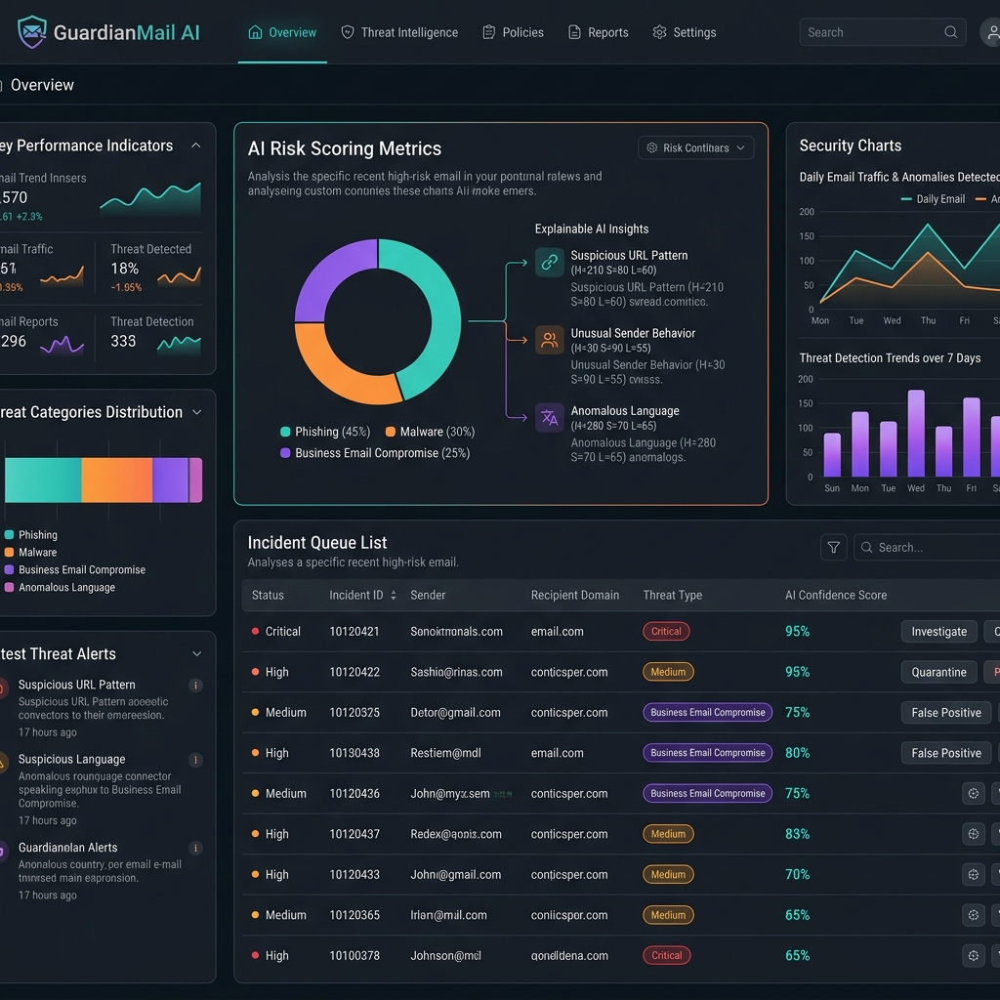
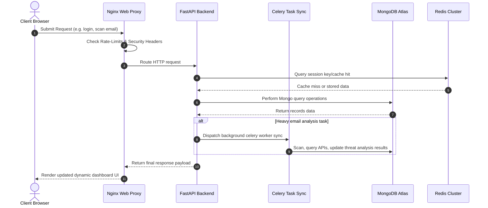
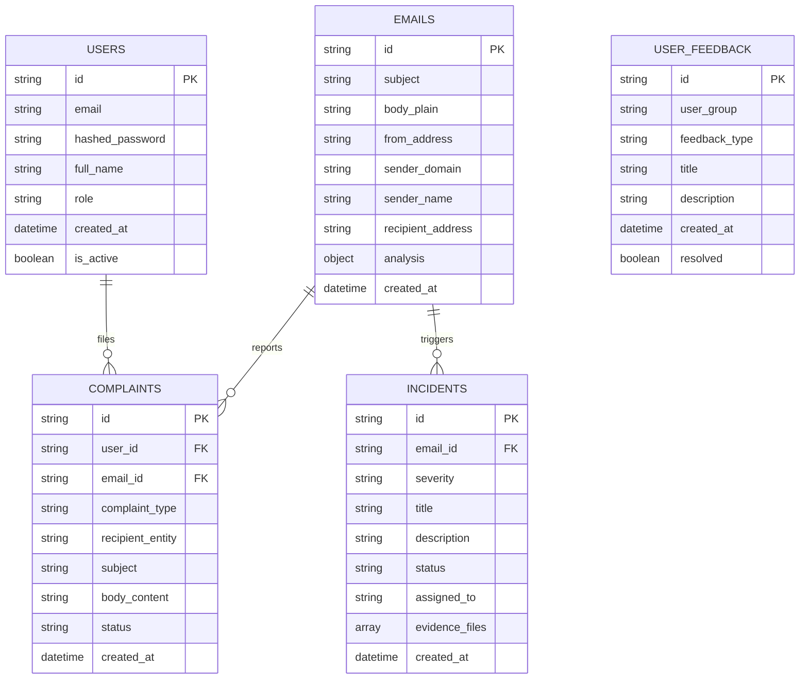

# GuardianMail AI - Enterprise Email Threat Analysis & Security Response Platform

GuardianMail AI is an enterprise-grade cybersecurity platform that automates email analysis, threat detection, incident management, and automated abuse reports generation. It integrates deep heuristics, AI models, and optical character recognition (OCR) parsing to evaluate email security risks.

---

## 1. Visual Previews

### SOC Analyst Operations Dashboard


### Email Threat Analysis Detail Screen


---

## 2. System Architecture

The sequence diagram below displays how user actions navigate the reverse proxy gate limits, hit cached objects, perform database checks, and trigger asynchronous celery workers for scanning:



---

## 3. Database Entity-Relationship (ER) Schema

The following entity diagram presents the data layout of the collections stored inside MongoDB Atlas:



---

## 4. Technology Stack

- **Frontend**: React 18, TypeScript, TailwindCSS, React Query, Axios, Vitest.
- **Backend**: FastAPI (Python 3.12), Motor (Async MongoDB), Celery, Redis.
- **Database & Cache**: MongoDB Atlas, Redis Cache.
- **Observability**: Prometheus, Grafana dashboards, JSON Logging.
- **Infrastructure**: Docker, Nginx Proxies, GitHub Actions CI/CD pipelines, Terraform.

---

## 5. Directory Structure

```
guardianmail-ai/
├── .github/                  # CI/CD workflows (GitHub Actions)
├── backend/                  # FastAPI Web Server & Celery App
│   ├── app/
│   │   ├── api/              # Controllers and router endpoints
│   │   ├── database/         # Connection managers and indexes init
│   │   ├── logging/          # Structured JSON format log formats
│   │   ├── models/           # Pydantic schemas and database models
│   │   ├── services/         # Incident, attachment, and scans services
│   │   └── telemetry/        # OpenTelemetry tracing span wrappers
│   └── tests/                # Pytest suites and integration tests
├── frontend/                 # React Web App (Vite + TypeScript)
│   ├── src/
│   │   ├── api/              # Axios HTTP client provider configurations
│   │   ├── components/       # UI dashboard and login components
│   │   └── pages/            # Settings, Incident, and Workspace pages
│   └── Dockerfile            # Multi-stage static page hosting compilation
├── nginx/                    # Reverse-Proxy Gateway configurations
└── docker-compose.yml        # Multi-container orchestrator configuration
```

---

## 6. Quick Start & Setup Guide

### Local Environment Variables
Create a `.env` file at the root directory level based on `env.example`:
```bash
cp .env.example .env
```

### Docker Compose Quickstart
To build and launch all containers (API, Web, Worker, DB, Redis, proxies, Prometheus, Grafana):
```bash
docker-compose up -d --build
```

Access coordinates:
- **Frontend Dashboard**: `http://localhost`
- **FastAPI Documentation**: `http://localhost/docs` or `http://localhost:8000/docs`
- **Prometheus Telemetry**: `http://localhost:9090`
- **Grafana Visualization**: `http://localhost:3000`

---

## 7. Operations & SRE Playbooks

- **Operations Manual**: Refer to `DEPLOYMENT_GUIDE.md` for AWS ECS Fargate IaC configuration rules, SSL setups, and diagnostics health probes guidelines.
- **Recovery playbooks**: Refer to `SRE_DEPLOYMENT_RECOVERY.md` for AES-256 database backups creation, restore commands, and worker recovery guides.

---

## 8. Project Licensing
Distributed under the MIT License. Refer to the repository LICENSE file for guidelines.
