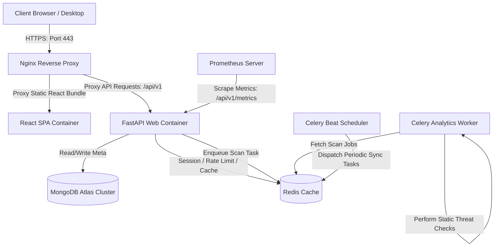

# SRE Operations Playbook: Deployments, Observability & Disaster Recovery

This operations manual details production-readiness setups, DevSecOps pipelines, SRE observability, automated backup workflows, and disaster recovery strategies for **GuardianMail AI**.

---

## 1. Production Architecture Overview

GuardianMail AI runs on a containerized, cloud-agnostic microservices architecture designed to decouple long-running static analysis from real-time API transactions:



### SLA Targets
- **Service Availability (Uptime)**: 99.9%
- **Recovery Time Objective (RTO)**: < 1 hour
- **Recovery Point Objective (RPO)**: < 24 hours (based on daily automated encrypted dumps)

---

## 2. Dockerization & Container Orchestration

Services are containerized to ensure stateless portability:
- **FastAPI Backend**: Packaged in [backend/Dockerfile](file:///c:/Users/Mubashirhussensk/OneDrive/Desktop/mail_analyzer/backend/Dockerfile) using lightweight `python:3.12-slim` layers.
- **React Frontend**: Packaged in [frontend/Dockerfile](file:///c:/Users/Mubashirhussensk/OneDrive/Desktop/mail_analyzer/frontend/Dockerfile) using a two-stage compilation flow (Node 20 + Nginx 1.25 Alpine static server).
- **Master Orchestrator**: Wired in [docker-compose.yml](file:///c:/Users/Mubashirhussensk/OneDrive/Desktop/mail_analyzer/docker-compose.yml) routing networks privately to avoid database port exposures.

---

## 3. Nginx API Gateway & Reverse Proxy

The front-facing proxy configuration is loaded in [nginx/nginx.conf](file:///c:/Users/Mubashirhussensk/OneDrive/Desktop/mail_analyzer/nginx/nginx.conf):
- **Rate Limiting**: Enforces `limit_req` throttling to `10 requests/sec` with burst thresholds to reject denial-of-service attempts.
- **Gzip Compression**: Compresses files larger than 10KB to improve page speed delivery.
- **OWASP Header Hardening**: Injects `X-Frame-Options`, `X-Content-Type-Options`, and strict CORS/CSP parameters to block clickjacking and cross-site scripting (XSS).

---

## 4. Health Checks & Diagnostic Probes

Kubernetes-native health routes are registered at `/api/v1/health`:
- `/health/live`: Simple ping ensuring API process is responsive.
- `/health/ready`: Confirms database connections (MongoDB and Redis) are established and pool sizes are active.
- `/database`: Connects and pings MongoDB clusters.
- `/redis`: Evaluates Redis network response.
- `/celery`: Inspects celery queue controls to confirm background SRE workers are active.

---

## 5. DevSecOps & CI/CD Pipeline

The SRE deployment pipeline is wired in [.github/workflows/ci-cd.yml](file:///c:/Users/Mubashirhussensk/OneDrive/Desktop/mail_analyzer/.github/workflows/ci-cd.yml):
- **Code Standards**: Runs `black`, `isort`, `ruff`, and `mypy` before compiling.
- **Static Security Audit**: Bandit scans the python source files to check for insecure code structures.
- **Dependency Audit**: `pip-audit` scans dependencies list against active CVE databases.
- **Image Compilation**: Builds and pushes Docker images to GitHub Container Registry (GHCR).

---

## 6. Observability, Prometheus & Grafana

Metrics telemetry configurations:
- **Prometheus Scraper**: Wired in [prometheus/prometheus.yml](file:///c:/Users/Mubashirhussensk/OneDrive/Desktop/mail_analyzer/prometheus/prometheus.yml) pulling metrics from `/api/v1/metrics` every 15 seconds.
- **Grafana Dashboards**: Visual template schemas in [grafana/dashboards/guardianmail_dashboard.json](file:///c:/Users/Mubashirhussensk/OneDrive/Desktop/mail_analyzer/grafana/dashboards/guardianmail_dashboard.json) visualizing API latency, 5xx server exceptions, CPU usage, and worker queue congestion.

---

## 7. Automated Backups & Disaster Recovery

### Automated Backups
Automated dumps are executed by [scripts/backup.sh](file:///c:/Users/Mubashirhussensk/OneDrive/Desktop/mail_analyzer/scripts/backup.sh):
1. Runs `mongodump` to pull compressed database dump archives.
2. Encrypts the archive using **OpenSSL AES-256** encryption keys.
3. Automatically deletes encrypted archives older than `7` days to respect storage retention parameters.

To schedule backups daily at 02:00 AM, register the script in the crontab:
```bash
0 2 * * * /bin/bash /workspace/scripts/backup.sh >> /var/log/backup.log 2>&1
```

### Disaster Recovery Restore Workflow
In the event of a cluster failure or database corruption, execute [scripts/restore.sh](file:///c:/Users/Mubashirhussensk/OneDrive/Desktop/mail_analyzer/scripts/restore.sh):
```bash
./scripts/restore.sh ./backups/guardianmail_backup_20260802_020000.archive.enc
```

---

## 8. Multi-Cloud Production Deployment Reference

### AWS Deployment (EKS / ECS Fargate)
1. **Secrets**: Register `MONGODB_URL`, `REDIS_URL`, and `SECRET_KEY` in **AWS Secrets Manager**.
2. **Fargate Orchestration**: Create an ECS Task Definition mapping the two containers (React served on port 80 proxying to FastAPI API on port 8000). Set CPU allocation parameters.
3. **Application Load Balancer (ALB)**: Place the task behind an ALB with SSL certificate termination mapped to **AWS Route 53**.

### Azure Deployment (AKS / App Service)
1. **Azure Key Vault**: Store credential secrets.
2. **Kubernetes manifests**: Mount `api` and `frontend` pods in an Azure Kubernetes Service (AKS) cluster.
3. **Ingress**: Deploy Azure Application Gateway ingress controller to route public HTTPs traffic.

### Google Cloud (Cloud Run / GKE)
1. **Secret Manager**: Create secure keys variables.
2. **Cloud Run**: Deploy stateless `api` and `frontend` services with auto-scaling instances configured to scale down to 0 on idle to optimize costs.
3. **Global Load Balancing**: Configure Google HTTP(S) Load Balancer for multi-region failover protection.
