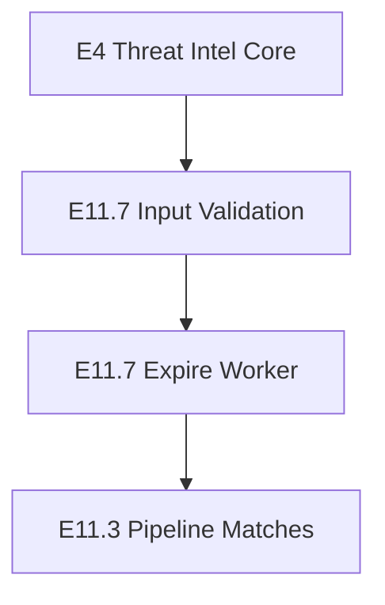

# E11.7 Architecture Discovery & Gap Analysis

## 1. Executive Summary

This report establishes the architectural baseline, integration points, and capabilities of the existing **E4 Threat Intelligence** platform, identifying specific enterprise gaps to be addressed in **E11.7 — Threat Intelligence & Adversary Intelligence Operations**. 

To prevent duplication of work, E11.7 will strictly extend E4 models and services rather than introducing redundant modules. All tenant boundaries, ingestion schemas, and scoring heuristics will be preserved, extending them only to insert strict validation filters, background TTL expirations, and deep integration with downstream execution layers.

---

## 2. Existing E4 Capabilities

The E4 platform is highly functional and structured across the following layers:

### Data Models & Schemas
* **`ThreatIndicator`**: Represents a normalized IOC database record containing type, values, confidence, severity, status, tags, and lifecycle timestamps.
* **`ThreatFeed`**: Configures background polling parameters, provider credentials, and polling intervals.
* **`ThreatCampaign`**: Groups correlated IOCs, affected incidents, and MITRE techniques under a campaign.
* **`ThreatActor`**: Attributes threat groups and techniques to campaigns and indicators.
* **`ThreatObservation`**: Tracks occurrences of indicator matches in email, user, or incident telemetry.

### Services & Adapters
* **`ThreatIntelService`**: Implements domain typosquatting, IDN unicode homograph detection, URL expansion trackers, and VirusTotal domain queries.
* **`BaseThreatIntelAdapter` & registry**: Standardizes client request retries and caches vendor checks in Redis. Includes adapters for `VirusTotal`, `AbuseIPDB`, `URLhaus`, and `AlienVault`.
* **`BaseIntelProvider` & vendor classes**: Decoupled vendor implementation layer (`GoogleSafeBrowsingProvider`, `VirusTotalProvider`, `AbuseIPDBProvider`, `DNSWhoisProvider`, `IPGeoProvider`).
* **`ThreatCorrelationService`**: Standardizes normalization, idempotent database checks, multi-signal compound scoring, and automated campaign clustering.

### APIs & Frontend
* Mapped REST endpoints for IOC CRUD operations, campaign verification, actor/technique queries, feed states, and campaign graph generation.
* Admin interface featuring tabs for IOC searches, campaign listings with SVG link graphs, and provider telemetry.

---

## 3. Existing E11 Integrations

* **E11.3 (Detections)**: Live email ingestion feeds domains and URLs through `ThreatIntelService` for typosquatting and VirusTotal checks, updating risk scoring variables.
* **E11.4 (Threat Hunting)**: Telemetry search AST queries domain and IP occurrences against `threat_indicators` database matches to flag matches.
* **E11.6 (Attack Graph & Campaign)**: Graph generation queries tenant-isolated and global IOC databases, linking them with E4 threat feed reputation scores.

---

## 4. Capability Matrix

| Capability | Existing | Partial | Missing | Implemented Where |
| :--- | :---: | :---: | :---: | :--- |
| **Normalized IOC Schema** | **X** | | | `threat_indicator.py` |
| **Vendor Adapters (VT, AbuseIPDB, URLhaus)** | **X** | | | `threat_intel_provider.py` |
| **Deduplication & Idempotent Ingestion** | **X** | | | `threat_correlation.py` |
| **Live Heuristic Scanning (Homographs)** | **X** | | | `threat_intel.py` |
| **Campaign Graph Visuals** | **X** | | | `threat_intelligence.py` / UI |
| **Feed Ingestion Daemons** | | **X** | | Feeds are modeled but background polling tasks are not executed |
| **Strict Regex IOC Validation** | | | **X** | Missing validation check before saving to DB |
| **Active Expiration Worker (TTL)** | | | **X** | IOCs have `expires_at` but no daemon reclaims expired items |
| **Downstream Pipeline live matching** | | **X** | | live matching is exact-value based and does not support normalized lookups |

---

## 5. Duplication Analysis

* **`ThreatIndicator` Models**: The platform has two models named `ThreatIndicator` (Pydantic `app.models.email.ThreatIndicator` for local risk markers, and MongoDB `app.models.threat_indicator.ThreatIndicator` for IOC records). While logically distinct, they can cause developer confusion.
* **Indicator Lookup Rules**: Live scanning (`threat_detector.py`) and threat hunting (`threat_hunting_service.py`) perform separate queries against the `threat_indicators` database. Normalization steps are done in-memory rather than relying on a centralized service lookup.

---

## 6. Security Findings

* **SSRF Risks in URL Expansion**: `ThreatIntelService.expand_short_url` performs a live HTTP HEAD request to redirect targets. There are no safe-subnet blocklists (e.g. blocking loopback `127.0.0.1` or link-local `169.254.169.254`), making it susceptible to SSRF attacks.
* **No Input Validation**: API routes do not sanitize or validate values based on their indicator type (e.g. checking if an IP contains valid octets, or a domain matches regex), allowing corrupted entries in the database.

---

## 7. Performance Findings

* **Query Latency**: Indexing is set on `organization_id`, but there is no compound index for `{"indicator_type": 1, "normalized_value": 1, "status": 1}` which would optimize live ingestion matches.
* **Feed Ingestion bottlenecks**: Serial vendor queries during ingestion can block celery workers. Async gathering or queuing should be introduced.

---

## 8. Frontend Gaps

* Analysts cannot trigger on-demand feed scans or manually trigger background validation jobs.
* Expiration policies and TTL boundaries are not visible or configurable from the feed management layout.

---

## 9. Recommended E11.7 Scope

To elevate the threat operations to enterprise standard, E11.7 will implement:
1. **SSRF Protections**: Apply a private IP blocklist to `expand_short_url`.
2. **Regex Validation Filters**: Add syntax validators for all ingestion paths.
3. **Daily Expiration Task**: Implement a Celery worker to sweep and transition IOC status to `EXPIRED` based on `expires_at`.
4. **Ingestion Index Optimization**: Add a compound database index on `normalized_value` + `indicator_type` + `status`.

---

## 10. Explicitly Out of Scope

* Designing a new database schema or rewriting E4 repository structures.
* Rewriting the frontend `ThreatIntelligence.tsx` component layout.

---

## 11. Dependency Map

