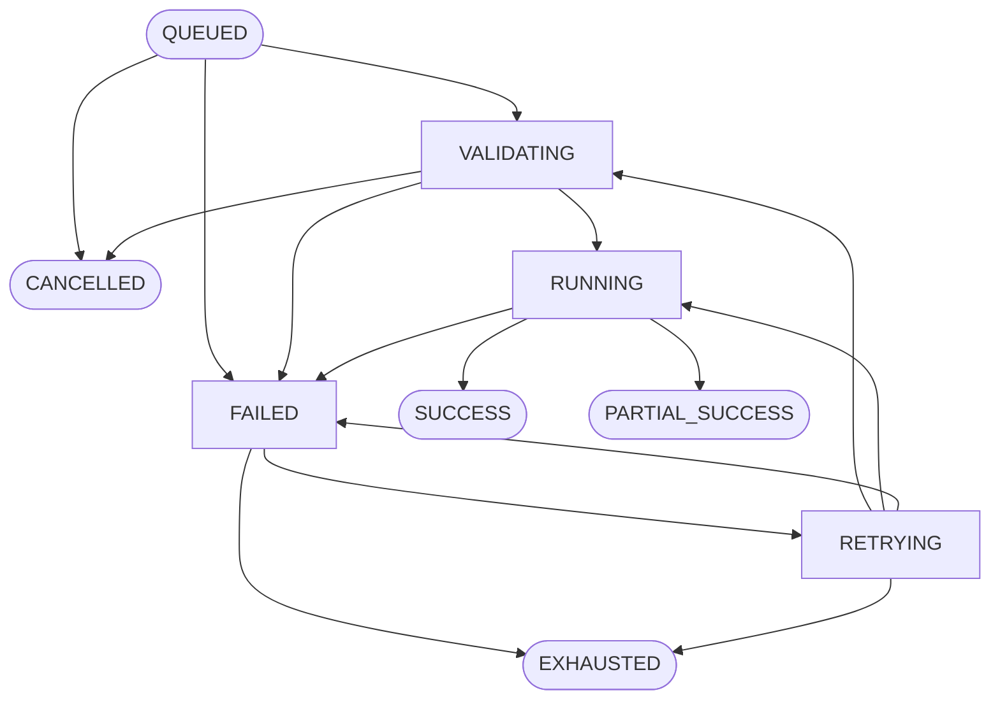

# E11.8.6 Response Operations & Execution Observability

This document details the architectural specifications, state machine validation rules, retry policies, and user interface controls implemented for the E11.8.6 Response Operations and Observability component of GuardianMail AI.

---

## 1. Architectural Architecture & Safety Boundaries

The Response Operations layer provides real-time state machine tracking, timeline synthesis, and metric monitoring for containment actions executed on behalf of GuardianMail AI. 

Crucially, this layer maintains the strict boundary where **E6 remains the sole execution owner**. Response Operations does not perform API execution or directly interact with security systems itself. Instead, it securely monitors the E6 Celery task dispatch queues, records transition audits, and governs authorized retry and cancellation procedures.

### Security and GRC Controls
1. **Connector Secrets Redaction**: At no point are API keys, OAuth tokens, authorization headers, or configuration secrets exposed. The API automatically redacts `authorization_reference` metadata to a secure UUID or mask (`REDACTED`) before transmitting response objects.
2. **Strict Tenant Isolation**: All operations, metrics, timelines, cancel requests, and manual retries verify that the request's authenticated tenant `organization_id` matches the document's `organization_id`. Any cross-tenant attempt immediately fails with a `404 Not Found` (never a `400 Bad Request` or `403 Forbidden` to prevent resource harvesting).
3. **Audit Log & GRC Evidence Propagation**: Status transitions write immutable events to `audit_logs`. A terminal state (such as `SUCCESS`, `PARTIAL_SUCCESS`, `EXHAUSTED`, or `CANCELLED`) automatically dispatches a compliance record to `grc_evidence` under control identifier `CTRL-SOAR-INTEGRITY`.

---

## 2. State Machine Transition Schema

Every execution request (`SOARExecutionRequest`) proceeds through an atomic state machine governed by the following valid transition graph:

### Valid Transition Matrix
| Source State | Allowed Destination States | Details / Triggers |
| :--- | :--- | :--- |
| **QUEUED** | `VALIDATING`, `CANCELLED`, `FAILED` | Background Celery task picks up execution request. |
| **VALIDATING** | `RUNNING`, `FAILED`, `CANCELLED` | Validation of safety boundaries, kill switches, and rate limits. |
| **RUNNING** | `SUCCESS`, `PARTIAL_SUCCESS`, `FAILED` | E6 SOAR connector dispatches containment payload. |
| **FAILED** | `RETRYING`, `EXHAUSTED` | Evaluated for transient failures vs retry exhaustion. |
| **RETRYING** | `VALIDATING`, `RUNNING`, `EXHAUSTED`, `FAILED` | Scheduled retry task attempts re-execution. |
| **SUCCESS** | *None (Terminal)* | Successful playbook execution; back-propagated to Response Decision. |
| **PARTIAL_SUCCESS** | *None (Terminal)* | Partial playbook completion (e.g., mail deleted from 8/10 boxes). |
| **EXHAUSTED** | *None (Terminal)* | Maximum retry attempts exceeded without recovery. |
| **CANCELLED** | *None (Terminal)* | Manually cancelled by authorized tenant operator. |

Any state transitions outside of this schema are rejected, raising a `ValueError` and creating a `EXECUTION_STATUS_CHANGE_REJECTED` audit log.

---

## 3. Failure Classification & Safe Retry Governance

When an E6 playbook execution encounters errors, the background worker classifies the failure to prevent infinite loops and run safely:

### Transient Failures (Retryable)
*   **CONNECTOR_TIMEOUT**: Simulated via network sockets, connection limits, or target URL pattern matches.
*   **CONNECTOR_UNAVAILABLE**: Network drops, API server throttles, or downstream gateway issues.
*   **Backoff Schedule**: Transient failures transition `FAILED` → `RETRYING`. The next attempt is scheduled via Celery using exponential/linear backoff:
    $$\text{Retry Delay (seconds)} = 5 \times \text{Attempt Count}$$
    At the scheduled time, Celery wakes up the worker to run the request again.

### Permanent Failures (Non-Retryable)
*   **VALIDATION_FAILURE**: Playbook resolution fails, credentials mismatch, or local kill switches are active.
*   **REPLAY_ATTEMPT**: Validation token consumed or re-used.
*   **Action**: Mapped to permanent codes, skipping retries and transitioning the request immediately to `EXHAUSTED`.

If `attempt_count` reaches `max_attempts` (default: 3), the request transitions to `EXHAUSTED` and the execution process halts permanently.

---

## 4. API Endpoints Reference

All endpoints are mounted under `/api/v1/response-operations` and require authenticated tenant scopes:

*   **`GET /executions`**: Retrieve a paginated list of SOAR execution requests (scopes: `response.read`).
*   **`GET /executions/{execution_id}`**: Get detailed execution request metadata, with credentials redacted (scopes: `response.read`).
*   **`GET /executions/{execution_id}/timeline`**: Get a unified chronological lifecycle timeline from detection, decisions, risk evaluations, approval tracking, to execution (scopes: `response.read`).
*   **`GET /executions/{execution_id}/audit`**: Get execution audit log records (scopes: `response.read`).
*   **`GET /metrics`**: Retrieve metrics cards aggregated over the past 30 days (scopes: `response.read`).
*   **`POST /executions/{execution_id}/cancel`**: Manually cancel an execution request in a non-terminal state (scopes: `response.manage`).
*   **`POST /executions/{execution_id}/retry`**: Manually trigger a retry for `FAILED` or `EXHAUSTED` executions, resetting attempt counts and queueing Celery (scopes: `response.execute`).

---

## 5. Console UI Layout

The front-end console component (`ResponseOperations.tsx`) provides an interactive React-based operations dashboard:

1.  **Summary Metrics Grid**: Displays cards for total runs, average duration, P95 duration, transient failures, and safety/kill switch blocks.
2.  **Safety Indicators**: A global badge displaying active security blocks and validation states.
3.  **Paginated Execution Grid**: Details the execution ID, recommended action, status pill, playbook name, attempts, and created timestamp. Clicking a row opens the drawer.
4.  **Details & Chronological Drawer**: Includes:
    *   Metadata overview with secrets redacted.
    *   Timeline diagram tracking the decision, four-eyes approval, token issuance, Celery queue states, worker execution, and GRC compliance evidence.
    *   **Operator Actions**: Dynamic `Cancel` and `Retry` buttons that appear contextually based on the state machine state.
