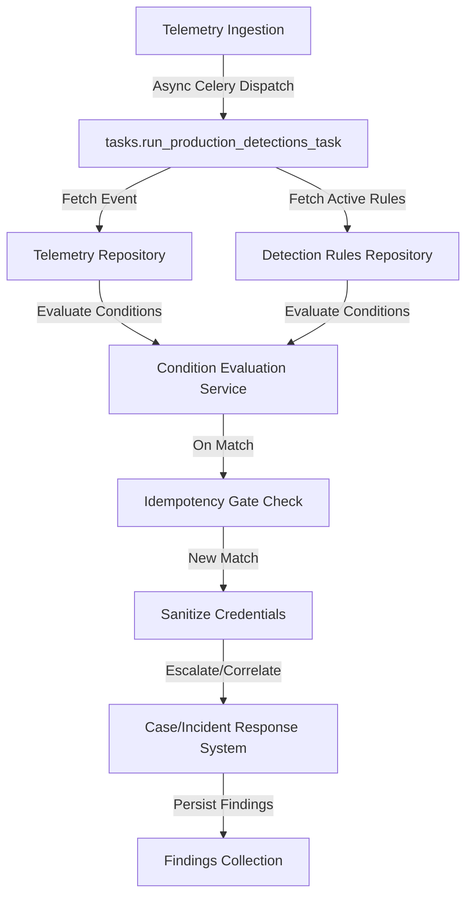

# E11.3 Production Detection Execution Engine - Engineering Documentation

This document describes the design, pipeline structure, error/retry behaviors, and tenant isolation safeguards of the Production Detection Execution Engine (E11.3).

---

## 1. Execution Pipeline

The execution engine processes telemetry events asynchronously in a non-blocking queue.

---

## 2. Production Eligibility

Detections are evaluated in production only if they meet the following eligibility conditions:
*   Rule is `ACTIVE` (`status == "ACTIVE"`). Draft, testing, review, retired, or disabled rules are ignored.
*   The event type or event source matches the rule's `data_sources` list.
*   Enforces partition locks (`event.organization_id == rule.organization_id`).

---

## 3. Idempotency & Deduplication

To prevent duplicate alerts when workers restart or messages are redelivered, an idempotency key is computed for each rule match:
$$\text{Idempotency Key} = \text{organization\_id} + ":" + \text{rule\_id} + ":" + \text{version\_number} + ":" + \text{event\_id}$$

If a finding with the same idempotency key already exists:
1.  The duplicate alert creation is suppressed.
2.  An audit log `FINDING_DEDUPLICATED` is registered.
3.  The `detection_deduplicated` metric is incremented.

---

## 4. Case System Correlation

To prevent alert fatigue and incident sprawl, matches are correlated to the existing case management system:
*   If an open incident (`Detected`, `Under Review`, `Investigating`) exists for the same tenant and same `affected_user` within the last **2 hours**:
    *   The finding is associated with that incident.
    *   A `DETECTION_CORRELATED` timeline event is logged.
*   If no such incident exists:
    *   A new `IncidentRecord` is created.
    *   An `INCIDENT_DETECTED` timeline event is recorded.

---

## 5. Security & Sensitive Data Redaction

Prior to recording evidence, any fields containing sensitive words like `password`, `secret`, `token`, `key`, or `auth` are redacted with `[REDACTED]` to prevent credential leakages into finding databases or investigative consoles.
All database queries partition collections strictly by `organization_id` to enforce tenant isolation.

---

## 6. Known Limitations & Future Correlation Models

> [!NOTE]
> The current **2-hour same-user** correlation heuristic is a baseline implementation. While it prevents incident sprawl under rapid fire rules matching, it should not be treated as a permanent enterprise correlation model.
>
> Future E11 phases (specifically correlation and threat hunting workstreams) will supersede this heuristic with a multi-signal model utilizing:
> *   Shared devices or IP addresses
> *   Matched MITRE ATT&CK techniques (TTP alignment)
> *   Cross-tenant or cross-user campaign indicators (E4/E9 integration)

