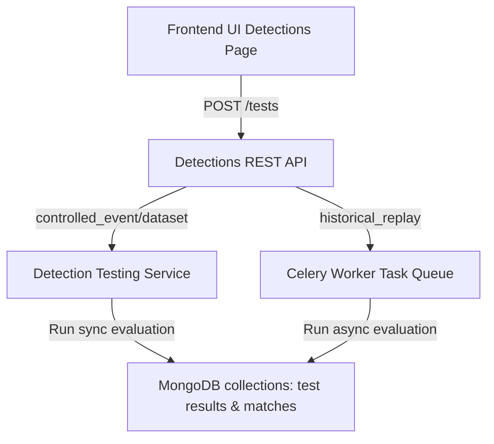

# E11.2 Detection Testing & Validation - Engineering Documentation

This document describes the design, data structures, execution flow, and verification patterns of the Detection Testing and Validation engine (E11.2) built on top of the GuardianMail AI security platform.

---

## 1. Architectural Overview

The Detection Testing and Validation engine allows security teams to validate detection rule logic against simulated payloads or historical telemetry. This workflow prevents false positives and logic regressions before rules are promoted to staging or production.

---

## 2. Data Models (`detection_testing.py`)

### `TestCase` (Sub-schema)
* Represents an individual event unit and the ground-truth expectation.
* `input_event`: Explicit telemetry fields payload dict.
* `expected_match`: Boolean flag.

### `DetectionTest` (Collection: `detection_tests`)
* Stores configurations for testing.
* `rule_id`: References the parent rule.
* `test_type`: `controlled_event` or `historical_replay`.
* `test_cases`: Array of `TestCase` items.
* `status`: `PENDING`, `RUNNING`, `PASSED`, `FAILED`, `ERROR`, `CANCELLED`.

### `DetectionTestResult` (Collection: `detection_test_results`)
* Stores aggregated run outcomes.
* Calculates:
  $$\text{Precision} = \frac{\text{True Positives}}{\text{True Positives} + \text{False Positives}}$$
  $$\text{Recall} = \frac{\text{True Positives}}{\text{True Positives} + \text{False Negatives}}$$
  $$\text{F1 Score} = \frac{2 \times \text{Precision} \times \text{Recall}}{\text{Precision} + \text{Recall}}$$

### `DetectionTestMatch` (Collection: `detection_test_matches`)
* Logs matches with redacted authentication/secret data.

---

## 3. REST API Interface

All endpoints enforce tenant isolation checks and require permission scopes:
* `GET /api/v1/detections/{id}/tests`: View test configurations.
* `POST /api/v1/detections/{id}/tests`: Define a test.
* `POST /api/v1/detections/{id}/tests/{test_id}/run`: Run test.
* `POST /api/v1/detections/{id}/tests/{test_id}/cancel`: Request test cancellation.
* `POST /api/v1/detections/{id}/compare-versions`: Compare version results.

---

## 4. Security Gates (RBAC & Multi-Tenancy)

Multi-tenancy isolation is enforced at the repository query level using `TenantContext.organization_id`.
Permissions:
* `telemetry.read`: View tests, results, and matches.
* `telemetry.manage`: Create tests, run evaluation, or cancel active runs.
