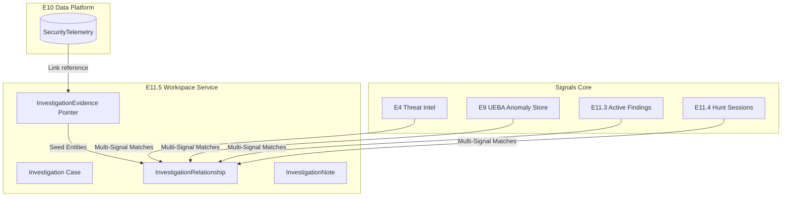

# E11.5 — Enterprise Investigation & Correlation Workspace

## 1. Overview

The Enterprise Investigation & Correlation Workspace (`/security/investigations`) is a unified analytics container allowing security analysts to pivot, correlate, and analyze active threats. It avoids raw telemetry replication by leveraging normalized, lightweight database pointers to existing records.

---

## 2. Architecture & Data Flow

---

## 3. Data Models

### `Investigation`
Tracks the high-level metadata, assignee, priority, severity, and workflow state transitions (`DRAFT` -> `OPEN` -> `INVESTIGATING` -> `CONTAINED` -> `RESOLVED` -> `CLOSED`).

### `InvestigationEvidence`
Normalized references storing the target item's type (e.g. `SECURITY_EVENT`, `DETECTION_FINDING`, `USER`, `IP`) and source identifier `source_id`.

### `InvestigationNote`
Analyst comments on findings, automatically logged with timestamp and author signatures.

### `InvestigationRelationship`
Extracted nodes and linkages demonstrating threat connections (e.g. `USER_CONNECTED_TO_IP`, `UEBA_FLAGGED_USER`, `IOC_MATCHED_EVENT`) with deterministic confidence ratings.

---

## 4. Deterministic Correlation Signals

When an analyst triggers the correlation engine, the service:
1. Gathers all linked evidence.
2. Extracts seed entities: Users, IPs, Domains, and Devices.
3. Applies rule-based checks within a **2-hour window**:
   * **USER_CONNECTED_TO_IP**: Matches login/auth syslog events to User and source IP.
   * **IOC_MATCHED_EVENT**: Correlates IPs, Domains, or URLs with active E4 Threat Indicators.
   * **UEBA_FLAGGED_USER**: Interrogates E9 ML feature store for anomalous risk scores (`>= 0.50`).
   * **DETECTION_MATCHED_EVENT**: Correlates active telemetry events with E11.3 active findings.
   * **FINDING_ESCALATED_TO_INCIDENT**: Identifies escalated Incident case connections.
4. Enforces safety limits: Max 50 relationships, max 20 seed entities, and max 100 evidence items per investigation.

---

## 5. UI Workspace

* **Sidebar Listing**: Sorts and filters active case folders.
* **Header details**: Tracks status transitions, owner, and severity levels.
* **Unified Timeline**: Chronologically assembles evidence attachments, notes additions, and relationship discoveries.
* **Evidence Linker Panel**: Allows link creation with existence validation.
* **Entities Pivoting Drawer**: Displays isolated asset categories.
* **Relationships Panel**: Discloses clear confidence justification texts.
* **Integrations Panel**: Simulates E6 SOAR automated playbooks and E7 GRC compliance evidence export.
* **E5 Copilot grounding**: Connects directly to Chat Grounding for conversational citations.
