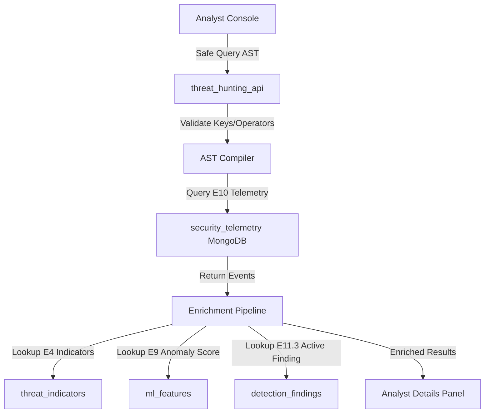

# E11.4 Threat Hunting Console - Engineering Documentation

This document describes the design, safe query compilation, and multi-signal enrichment integration of the Enterprise Threat Hunting module (E11.4).

---

## 1. Architectural Overview

The Threat Hunting console is an analyst intelligence layer over the E10 security telemetry data storage. It is explicitly designed to query existing partitioned datasets without creating a second telemetry/search database.

---

## 2. Safe AST Query Builder

To prevent raw query injection, command injections, or unauthorized MongoDB `$where` expressions, the backend compiles a structured Abstract Syntax Tree (AST):

### Whitelisted Fields
*   `event_id`
*   `event_type`
*   `severity`
*   `source`
*   `timestamp`
*   `rolling_rate_60s`
*   `user_id`
*   `payload.user`
*   `payload.ip`
*   `payload.domain`

### Whitelisted Operators
*   `eq` (equality mapping)
*   `ne` (not equal mapping)
*   `contains` (regex escaped string matches)
*   `in` (member lists checking)
*   `gt` (greater than in-memory offset filter)
*   `lt` (less than in-memory offset filter)

If any parameter or key falls outside this whitelisted definition, the query builder throws a `ValueError` immediately.

---

## 3. Multi-Signal Enrichment (E4 / E9 / E11.3)

For each returned event matching the AST, the engine enriches it with contextual indicators:
*   **E4 Threat Intelligence**: Cross-references `payload.domain` or `payload.ip` against the `threat_indicators` collection and runs lookalike-domain heuristics.
*   **E9 UEBA Feature Store**: Resolves `ml_features` vectors linked to the user context and fetches user risk score indicators.
*   **E11.3 Detections**: Resolves existing alerts inside `detection_findings` to flag duplicate investigations.

---

## 4. Incident Escalation & Case Integration

When an analyst flags a telemetry event as malicious:
1.  A manual `HuntFinding` document is registered in MongoDB.
2.  The event is escalated by creating a standard `IncidentRecord` inside the incidents case management system.
3.  An initial timeline log `INCIDENT_DETECTED` is recorded.
4.  The `HuntFinding` is updated with the generated `incident_id` case linkage.

> [!IMPORTANT]
> **Incident Correlation Limitation**
> Manual escalations from the threat hunting console register a new incident case. However, automated correlation engines (E11.3) rely on a simple 2-hour same-user window to group alerts. Future correlation workstreams will transition this baseline model to a multi-dimensional classifier based on matching techniques (MITRE ATT&CK), shared indicators of compromise (IP/domains), and device entities.
