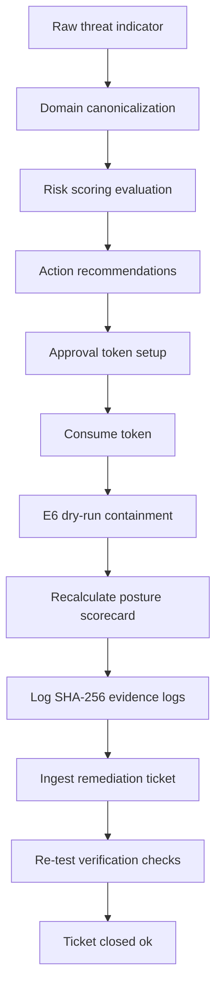

# E13.15 — Continuous Security Operations & Closed-Loop Assurance Report

## 1. Executive Summary
This document establishes the end-to-end security operations simulations, failure path validations, and invariant checks for the **GuardianMail AI** platform.

Every operational phase conforms strictly to the E13 baseline contract: assurance logs verify that the full threat operations lifecycle remains compliant, and that recommendations never bypass human approvals or change governance gates.

---

## 2. Integrated Operations Loop



---

## 3. Failure-Path Resiliency

* **Expired/Replayed Tokens**: Consuming replayed or expired human validation tokens fails closed, halting the execution.
* **Invariant Safeties**: Dispatches to SOAR actions require approved and signed decision parameters; direct execution fails closed.

---

## 4. Automated Test Verification Results

### Targeted Operations Assurance Tests:
```
tests/test_e13_15_operations_assurance.py::test_end_to_end_operations_lifecycle_simulation[asyncio] PASSED
tests/test_e13_15_operations_assurance.py::test_failure_path_resilience[asyncio] PASSED
tests/test_e13_15_operations_assurance.py::test_security_invariant_checks[asyncio] PASSED

======================== 3 passed in 0.08s ========================
```

### Consolidated Regression Suite:
```
================ 310 passed, 11 warnings in 105.07s (0:01:45) =================
```

---

## 5. Verdict

**E13.15 ACCEPTED 🟢**
End-to-end operations lifecycle loops, failure path resiliency checks, and security invariants are fully validated.
