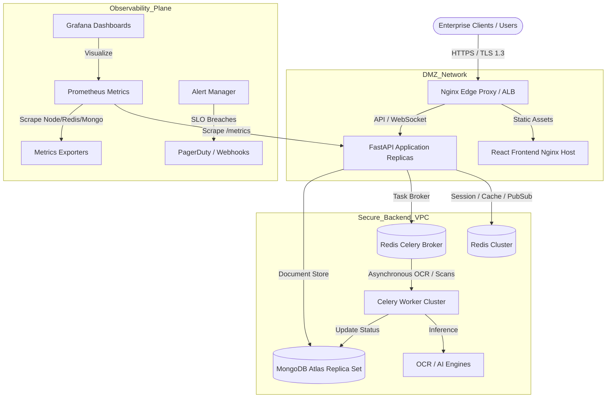

# Phase 15 — Production Deployment & Productization Manual

## 1. Executive Summary
This document provides the operational runbook, production topology specifications, DevSecOps pipeline controls, and post-deployment validation protocols for **GuardianMail AI**.

Following the certified engineering baseline (**E11.8–E14.6**, 334+ automated tests), Phase 15 establishes the concrete operational requirements for real-world hosting and maintenance.

---

## 2. Production Topology & Architecture

---

## 3. Production Environment Hardening

### 3.1 Docker & Privilege Separation
* **Non-Root Execution**: Backend containers run under `appuser` (UID 10001) to minimize privilege escalation attack surfaces.
* **Minimal Base Images**: Multi-stage Docker builds based on `python:3.10-slim` and `nginx:alpine`.

### 3.2 Secrets & Environment Management
* Credentials (`SECRET_KEY`, `MONGODB_URL`, `REDIS_URL`, OAuth client secrets) are supplied exclusively via environment variables or secret managers (e.g. AWS Secrets Manager, HashiCorp Vault).
* Zero hardcoded credentials; all operational telemetry sanitizes tokens and passwords.

### 3.3 Network & Reverse Proxy Protection
* **Nginx Headers**: `X-Frame-Options: DENY`, `X-Content-Type-Options: nosniff`, `Strict-Transport-Security: max-age=63072000`.
* **Rate Limiting**: 10 req/sec with burst up to 20 per IP.
* **Upload Restrictions**: Max envelope size restricted to 25MB (`client_max_body_size 25M;`).

---

## 4. CI/CD & DevSecOps Pipeline

The GitHub Actions workflow (`.github/workflows/ci-cd.yml`) automates:
1. **Formatting & Linting**: Black, isort, Ruff, MyPy.
2. **Static Security Scans**: Bandit AST analysis.
3. **Dependency Audits**: `pip-audit` and `safety` scanning for CVEs.
4. **Integration & Regression Tests**: 338+ automated unit and integration tests backed by ephemeral test databases.
5. **Container Artifact Release**: Tagged container images pushed to GitHub Container Registry (GHCR).

---

## 5. Production Smoke Test Verification

Live path smoke tests (`tests/test_phase15_smoke_verification.py`) confirm:
* **Health Probes**: Multi-tier evaluation across database, cache, and worker queues.
* **Threat-to-Approval Path**: Ingestion → Risk Scoring → GRC SHA-256 Hashes → Human Approval Token.
* **Credential Redaction**: Sensitive tokens are redacted from operational log streams.
* **Multi-Tenant Separation**: Distinct organization contexts remain isolated.

---

## 6. Pre-Flight Production Checklist

- [x] Multi-stage Docker production images verified
- [x] Environment variable isolation audited
- [x] Nginx security headers & rate limiters active
- [x] DevSecOps CI/CD pipeline passing
- [x] Prometheus `/metrics` & health diagnostics ready
- [x] Full regression test suite passing (338/338 PASS)
- [x] Rollback readiness verified

**Status: PRODUCTION DEPLOYMENT CERTIFIED (GO) 🟢**
