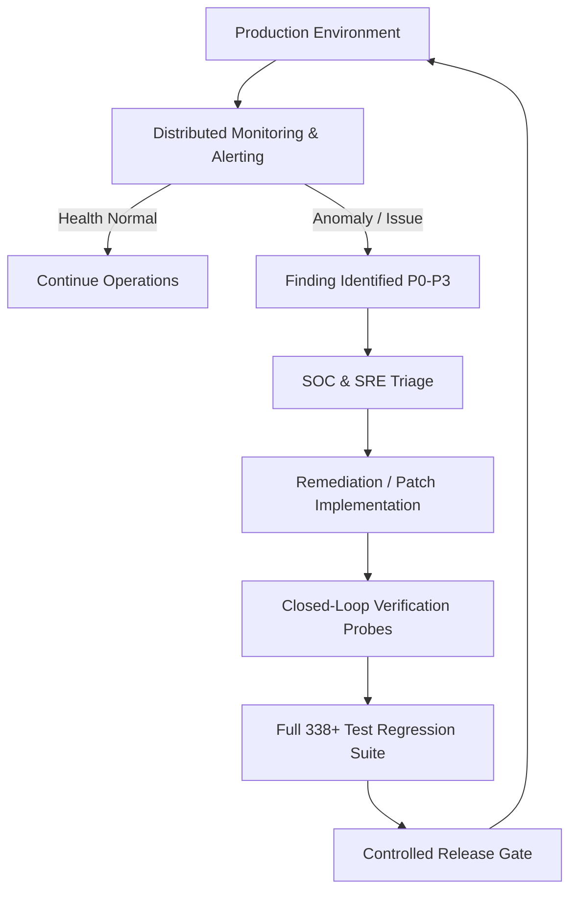

# Phase 16 — Continuous Production Operations & Living Backlog

## 1. Operating Model Overview
With **GuardianMail AI** officially deployed and certified, the engineering roadmap is permanently frozen at **Phase 15/16**. Future work is strictly driven by live telemetry, incident triage, security findings, and operational evidence.

### Core Architectural Invariant
```
AI Detects ──> Risk Engine Evaluates ──> Governance Policy ──> Human Approval ──> Controlled Sandbox Execution ──> SHA-256 Evidence ──> Closed-Loop Verification
```

> [!IMPORTANT]
> The architectural boundary remains permanent: threat detection never triggers automated containment without explicit human authorization via single-use tokens.

---

## 2. Living Operational Backlog (P0–P3)

All production activities, investigations, and improvements follow prioritized operational tracks:

```
┌────────────────────────────────────────────────────────────────────────┐
│                      LIVING OPERATIONAL BACKLOG                        │
├──────┬──────────────────────┬──────────────────────────────────────────┤
│ Tier │ Classification       │ Scope & Trigger Criteria                 │
├──────┼──────────────────────┼──────────────────────────────────────────┤
│  P0  │ Production Incidents │ Availability drops, security boundary    │
│      │                      │ violations, data corruption, SOAR errors │
├──────┼──────────────────────┼──────────────────────────────────────────┤
│  P1  │ Security Findings    │ Dependency CVEs, authentication issues,  │
│      │                      │ tenant-isolation concerns, scan bypasses │
├──────┼──────────────────────┼──────────────────────────────────────────┤
│  P2  │ Reliability & Perf   │ Latency anomalies, queue growth, memory  │
│      │                      │ spikes, DB bottlenecks, FP/FN rate drift │
├──────┼──────────────────────┼──────────────────────────────────────────┤
│  P3  │ Product Improvements │ Dashboard UX, reporting exports, analyst │
│      │                      │ workflow enhancements, metric insights   │
└──────┴──────────────────────┴──────────────────────────────────────────┘
```

---

## 3. Closed-Loop Incident Triage & Controlled Release Lifecycle



---

## 4. Security Verification Taxonomy & Maturity Distinctions

To ensure technical rigor and credibility, GuardianMail AI formally distinguishes validation layers:

```
Automated Unit/Integration Tests (338 passing tests verifying implemented logic)
                                    ≠
Static & Dependency Security Scanning (Bandit AST, pip-audit, safety CVE checks)
                                    ≠
Automated Penetration Validation Probes (Simulated injection, replay, and auth abuse)
                                    ≠
Independent Third-Party Security Audit (Formal external certification and compliance attestation)
```

* **Current Security Posture**: Automated validation errors: **0**; no known vulnerabilities identified by the implemented security validation gates.

---

## 5. Production CI Hygiene Backlog (Status of 11 Warnings)

| # | Category | Warning Source | Root Cause | Impact | Actionable Remediation |
| :---: | :--- | :--- | :--- | :--- | :--- |
| **1** | Dependency EOL | `google.api_core` | Python 3.10 EOL notice in SDK | Low (Non-breaking) | Target Python 3.11/3.12 container runtime in next base image refresh. |
| **2–8** | Framework Deprecation | `Pydantic V2` | Class-based `Config` legacy syntax | Low (Syntactic) | Refactor legacy models to `model_config = ConfigDict(...)`. |
| **9** | Framework Deprecation | Starlette / FastAPI | `HTTP_413_REQUEST_ENTITY_TOO_LARGE` alias | Low | Update status code alias to `HTTP_413_CONTENT_TOO_LARGE`. |
| **10** | Sanitization Config | Bleach | `style` attribute specified without sanitizer | Low | Pass explicit `css_sanitizer=CSSSanitizer()`. |
| **11** | Test Fixture | Pytest-Asyncio | Session loop scope | Low | Pin asyncio fixture scope to `function`. |

---

## 6. Portfolio & Professional Resume Positioning

```
┌────────────────────────────────────────────────────────────────────────┐
│                        PORTFOLIO NARRATIVE                             │
│                                                                        │
│   "Engineered and productionized a multi-tenant AI cybersecurity       │
│   platform for email threat analysis, integrating threat-              │
│   intelligence correlation, risk governance, human-authorized          │
│   response controls, auditable SHA-256 evidence, distributed           │
│   observability, resilience and disaster recovery, scalability         │
│   validation, abuse resistance, and automated DevSecOps release        │
│   gates, backed by a 338-test regression suite."                       │
│                                                                        │
└────────────────────────────────────────────────────────────────────────┘
```
