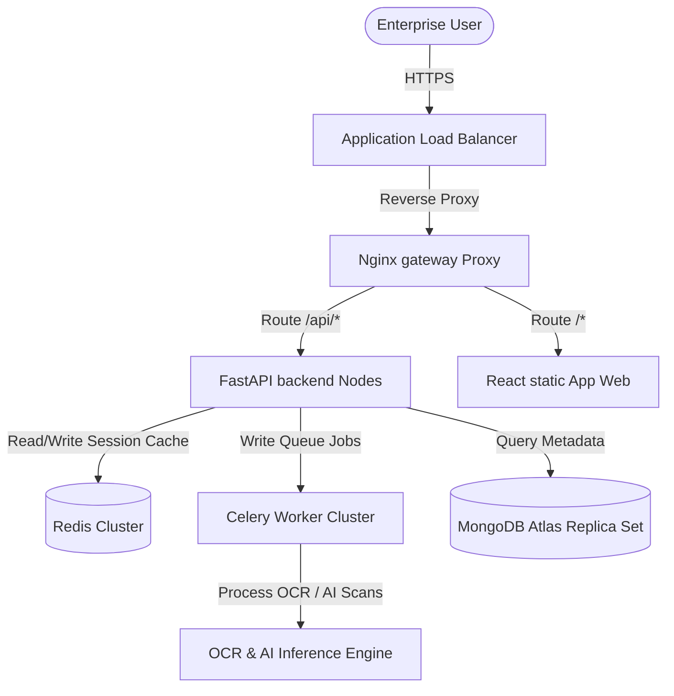

# Enterprise Production Deployment & Operations Manual

This guide describes operational setups, deployment routines, security guidelines, and disaster recovery playbooks for **GuardianMail AI**.

---

## 1. Production Architecture Overview

The system is designed following high-availability, stateless, and cloud-native standards:



---

## 2. Docker & Container Profiles

All docker images run under restricted privileges:
- **FastAPI / Celery Workers**: Built via [Dockerfile](file:///c:/Users/Mubashirhussensk/OneDrive/Desktop/mail_analyzer/backend/Dockerfile) running under a non-root system user `appuser` (UID 10001).
- **React Nginx host**: Optimized multi-stage build caching assets using Stage 1 Node compiler and Stage 2 minimal Alpine Nginx.

To spin up local production orchestrations:
```bash
docker-compose up -d --build
```

---

## 3. Security Proxies & HTTPS Redirects

Nginx handles TLS terminations and request routing. The production proxy is configured with:
1. **Security Headers**:
   - `X-Frame-Options: DENY` (Anti-clickjacking protection).
   - `X-Content-Type-Options: nosniff` (MIME-sniffing blocker).
   - Strict Content Security Policies (CSP).
   - Strict-Transport-Security (HSTS) with 2-year caching durations.
2. **API Protection Bounds**:
   - Limit file upload size strictly to 10MB via `client_max_body_size 10M;`.
   - Rate limit requests to 10/s with bursts of up to 20 requests per IP address.

---

## 4. Disaster Recovery & Encrypted Backups Playbook

We use the pre-built operational shell scripts inside `/scripts` to automate DB backups and restores:

### Encrypted Backup Generation
To trigger a secure AES-256 compressed MongoDB archive:
```bash
./scripts/backup.sh
```
This writes a password-protected zip file to `./backups/` and auto-purges logs older than 7 days.

### Restore Procedure
To restore state from an encrypted archive:
```bash
./scripts/restore.sh ./backups/mongodb_backup_YYYYMMDD_HHMMSS.tar.gz.enc
```

---

## 5. Health Probe Integration & Telemetry

Exposed health diagnostic endpoints are fully compatible with AWS ALB target group checks, Kubernetes Liveness/Readiness probes, and Docker container stats tools:
- `/health/live`: Container is active.
- `/health/ready`: Confirms database and cache pools are fully operational.
- `/database`: Connects and pings MongoDB.
- `/redis`: Connects and pings Redis.
- `/celery`: Scrapes worker queues and registers active worker agents.
