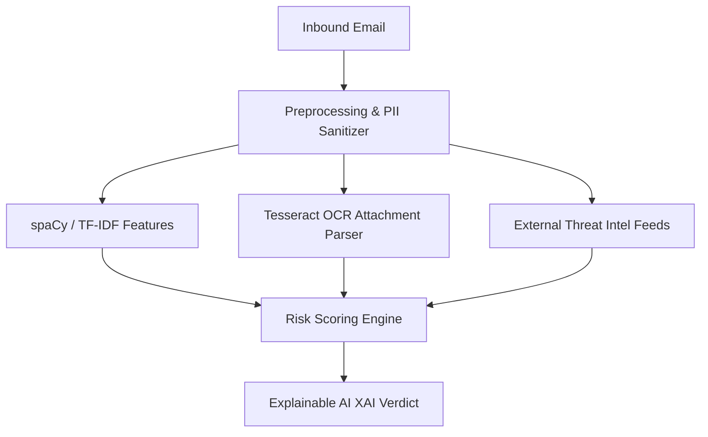

# AI & Threat Intelligence Architecture Specification: GuardianMail AI

---

## Section 1: AI Vision

GuardianMail AI implements a hybrid detection architecture that combines deterministic rule engines, traditional machine learning models, and explainable natural language processing (NLP) to secure enterprise communication channels:
- **Responsible & Responsible AI**: Model results must be explainable, non-biased, and respect tenant privacy boundaries.
- **Explainability**: Every threat alert is accompanied by contextual, human-readable indicator details mapping *why* the message was flagged.
- **Privacy-First AI**: Message bodies undergo strict local preprocessing and sanitization, scrubbing sensitive user PII before evaluations are executed.

---

## Section 2: Complete AI Architecture

- **Feature Pipeline**: Preprocesses text metrics, calculates sentence embeddings, and decodes attachment QR-code strings.
- **Model Registry**: Automatically manages, evaluates, and deploys model files through MLOps pipelines.

---

## Section 3: Threat Detection Pipeline

1. **Email Received**: Inbound message hooks trigger metadata extraction.
2. **Authentication Verification**: Inspects raw headers for SPF, DKIM, and DMARC alignments.
3. **URL Resolution**: Decodes shorteners and verifies DNS/WHOIS age records.
4. **OCR Parsing**: Extracts image attachment contents and QR-code targets.
5. **Semantic Content Analysis**: Categorizes body intents (financial requests, urgency, password changes).
6. **Risk Engine Aggregation**: Integrates the results of individual checkers to compute a weighted risk score.
7. **XAI Verdict**: Outputs explainable indicators, evidence logs, and recommended actions.

---

## Section 4: Email Header Analysis

Header scanning evaluates structural anomalies:
- **Authentication Alignment**: Detects spoofing by checking mismatched `From` addresses and envelope headers.
- **Hop Chain Anomalies**: Parses the `Received` chain headers to identify relays originating from high-risk hosting providers or regions.

---

## Section 5: Content Analysis

- **Urgency Detection**: Evaluates message timelines for time-pressure indicators ("pay today", "immediate wire transfer").
- **Financial Fraud**: Scans for routing number edits, request patterns for invoices, or gift card requests.
- **Analyst Warnings**: Generates explainable, context-aware notification banners to display to target recipients.

---

## Section 6: Natural Language Processing (NLP)

- **Tokenization & Parsing (spaCy)**: Cleans text strings, resolves stop words, and identifies named entities (CEOs, organizations).
- **Vectorizer (TF-IDF)**: Calculates term frequencies against trained datasets to detect BEC keywords.
- **Classification Embeddings**: Matches semantic contexts with predefined attack patterns (credential harvesting, payroll changes).

---

## Section 7: Business Email Compromise (BEC)

BEC detection focuses on non-malware social engineering patterns:
- **Impersonation**: Cross-references sender display names with internal employee records to detect look-alike display names.
- **Payroll Fraud**: Identifies requests to update banking configurations.
- **Vendor Hijacking**: Compares billing data changes with historical payment baselines.

---

## Section 8: Brand Impersonation

- **Unicode Homographs**: Decodes cyrillic Unicode characters in sender domains, comparing results to common brands.
- **Typosquatting**: Calculates Levenshtein distances between domain names and known corporate domains.

---

## Section 9: URL Intelligence

- **Whois Age Validation**: Flags domains registered within the last 14 days.
- **Redirect Chain Tracker**: Follows HTTP headers to identify target URL redirection destinations.
- **SSL Verification**: Inspects site SSL certificates, checking target registries records.

---

## Section 10: Attachment Intelligence

- **Double Extension Filter**: Sanitizes filenames, blocking structures like `.pdf.exe`.
- **Macro Validation**: Checks document headers for scripts execution triggers.
- **Whitelisting**: Rejects executable binary types (`.exe`, `.sh`).

---

## Section 11: OCR Ingestion Pipeline

- **Text Extraction**: Uses Tesseract OCR to extract text from screenshots and embedded receipts.
- **QR Decoder**: Resolves QR images to extract embedded URLs, submitting target domains for reputation analysis.

---

## Section 12: Threat Intelligence Fusion

The platform aggregates threat scores from multiple intelligence feeds (VirusTotal, AbuseIPDB, URLhaus):
$$\text{Fused Score} = \frac{\sum (w_i \cdot \text{Score}_i)}{\sum w_i}$$
*Where $w_i$ is the feed confidence weight.*

---

## Section 13: Behavioral Analysis

- Monitors email exchange frequency between senders and recipients.
- Flags incoming emails from unknown external senders that request actions normally reserved for internal communications.

---

## Section 14: Risk Scoring Engine

The scoring engine aggregates results across 7 distinct categories using weighted indicators:
- **Authentication**: Weight 0.15 (SPF/DKIM/DMARC alignment)
- **URL Security**: Weight 0.20 (WHOIS age, redirect chains, feed hits)
- **Content Metrics**: Weight 0.20 (Urgency keywords, BEC intent)
- **OCR extractions**: Weight 0.15 (QR code phishing, malicious image text)
- **Attachment security**: Weight 0.15 (Double extensions, macros)
- **Behavioral profiles**: Weight 0.15 (New sender, time anomalies)

---

## Section 15: Explainable AI (XAI)

Every positive threat classification must output:
1. **Verdict**: (e.g. PHISHING).
2. **Confidence**: Scoring scale `[0 - 100]`.
3. **Primary Indicators**: Mapped reasons (e.g., Unicode homograph domain similarity, invalid DKIM authentication).
4. **Recommended Containment**: Step-by-step instructions for the SOC analyst (quarantine message, block domain).

---

## Section 16: Model Registry

- Model metadata documents active algorithms configurations and F1 evaluations metrics.
- Registry controls rollback rules if drift diagnostics detect a drop in accuracy.

---

## Section 17: Training Pipeline

- **Dataset collection**: Ingests safe corporate emails and verified phishing samples.
- **Preprocessing**: Cleans, parses, and formats data into standard JSON data objects.
- **Deployment**: Automatic pipeline deployment after validation scripts verify the model's accuracy.

---

## Section 18: Model Evaluation Metrics

- **Primary Metrics**: Precision, Recall, and F1 score.
- **Calibration Target**: False positive rate must remain below 0.1% to prevent alert fatigue in the SOC workspace.

---

## Section 19: Human-In-The-Loop Feedback

- Allows SOC analysts to flag false positives and false negatives directly from the UI.
- Feedback updates are written to MongoDB Atlas collections, queuing samples for model retraining.

---

## Section 20: MLOps

- Automated pipelines run drift detection tests weekly.
- If classification confidence drops below 80%, retraining jobs are scheduled automatically.

---

## Section 21: Future AI Roadmap

- **LLM Integrations**: Generate human-like conversational summaries explaining complex, multi-stage attacks.
- **Graph AI Mapping**: Analyze connection logs to identify organizational communication patterns.

---

## Section 22: Architectural Decision Records (ADRs)

### ADR-04: Hybrid Risk Aggregation over Single End-to-End LLM
* **Decision**: Implement a hybrid risk scoring model combining lightweight classifier rules, OCR scanners, and domain checkers.
* **Trade-off**: A single LLM simplifies the stack but introduces higher API costs, latency, and hallucinations. A hybrid system ensures faster response times, deterministic reliability for signatures, and lower operational overhead.
