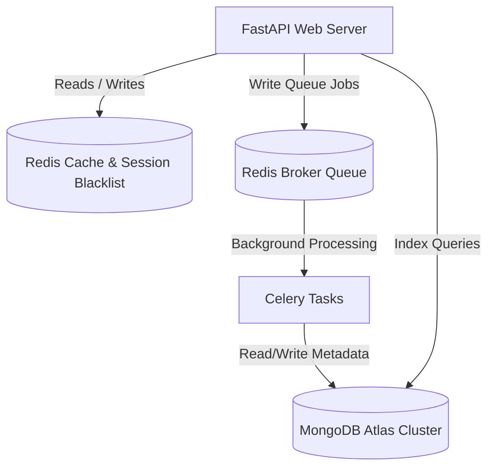

# Enterprise Database Architecture Specification: GuardianMail AI

---

## Section 1: Database Vision

GuardianMail AI relies on a high-availability, document-oriented data layer configured for high-performance indexing, secure tenant isolation, and strict compliance validation:
- **Scalability**: Stateless horizontal scaling of reader nodes with geo-replicated database clusters (MongoDB Atlas).
- **Performance**: Cap average database operations below 10 milliseconds using compound, text, and partial indexes.
- **Uptime**: Geo-distributed clusters targeting 99.999% data layer availability.
- **Security**: Field-level encryption for personally identifiable information (PII) to meet GDPR regulations.

---

## Section 2: Database Architecture



- **Reads/Writes Flow**: Inbound metadata is verified against Redis session caches before querying MongoDB Atlas.
- **Async Workers Logs**: Celery tasks parse attachments, compute threat indicators, write logs to Atlas, and notify Prometheus/Grafana scrapers.

---

## Section 3: Collections Specifications

### `users`
- **Purpose**: Managing analyst accounts, roles, and profiles.
- **Schema Validation**:
```json
{
  "$jsonSchema": {
    "bsonType": "object",
    "required": ["email", "hashed_password", "role", "organization_id"],
    "properties": {
      "email": { "bsonType": "string", "pattern": "^[a-zA-Z0-9._%+-]+@[a-zA-Z0-9.-]+\\.[a-zA-Z]{2,}$" },
      "hashed_password": { "bsonType": "string" },
      "role": { "enum": ["ADMIN", "SOC_ANALYST", "USER"] },
      "organization_id": { "bsonType": "objectId" }
    }
  }
}
```
- **Indexes**: Unique index on `email`.

### `emails`
- **Purpose**: Mail headers, body metrics, and parsed markers metadata.
- **Indexes**: Compound index on `(user_id_1, date_-1)`.

### `ioc_repository`
- **Purpose**: Target IP reputations, file hashes, and campaign domain logs.
- **Indexes**: Unique compound index on `(value_1, type_1)`.

### `audit_logs`
- **Purpose**: Read-only tracking files for user activity compliance.
- **TTL**: Evict documents older than 365 days using index `(created_at_1)`.

---

## Section 4: Schema Design

- **Normalization Philosophy**: Embed structured, bounded metrics (e.g., mail headers, OCR sub-blocks) within Parent Documents to avoid join queries. Reference unbound, large documents (e.g. Evidence Packages, Complaints) using MongoDB `ObjectId`.
- **Versioning Strategy**: Add a root-level `__v` schema version field to support live migrations.

---

## Section 5: Indexing Strategy

1. **Compound Index `(user_id_1, date_-1)`**: Supports fast, chronologically sorted dashboard views.
2. **Text Index `(subject_text, body_plain_text)`**: Allows fast wildcard searches inside inboxes.
3. **TTL Index `(completed_at_1)`**: Cleans background queue status entries after 30 days.

---

## Section 6: Relationships

- **One-to-One (Embedded)**: Email analysis metadata embeds DKIM authentication status configurations directly.
- **One-to-Many (Referenced)**: User profiles reference organization definitions via `organization_id`.
- **Many-to-Many**: Campaign correlation records connect domains to target IP lists.

---

## Section 7: Aggregation Pipelines

### SOC Heatmap Aggregation
```javascript
db.emails.aggregate([
  { $match: { "analysis.verdict": { $ne: "SAFE" } } },
  { $group: { _id: "$analysis.verdict", count: { $sum: 1 } } }
]);
```

---

## Section 8: Redis Data Model

- **Session Blacklist**: Key format `token:blacklist:{jti}`, TTL aligned to JWT expiry.
- **Rate Limiting**: Key format `rate:ip:{ip_address}`, tracking connection counts within 60-second windows using standard sliding-window logs.

---

## Section 9: Repository Pattern & DDD

- **Mongo Repository**: Abstract Base Class (`BaseRepository`) exposing CRUD primitives using Motor.
- **Unit of Work**: Manages MongoDB sessions to guarantee transactional consistency across multi-document updates.

---

## Section 10: Transactions & Rollback Strategy

We run atomic operations where possible. For multi-collection updates (e.g. creating an incident and logging an audit event), we use MongoDB multi-document transactions:
```python
async with await client.start_session() as session:
    async with session.start_transaction():
        await db.incidents.insert_one(incident, session=session)
        await db.audit_logs.insert_one(audit, session=session)
```

---

## Section 11: AI Data Storage

- **Model Versions**: Tracks active training models' metadata.
- **Calibration Loop**: Logs user feedback to refine false-positive threat score thresholds.

---

## Section 12: Threat Intelligence Storage

- Maps URLs, attachment hashes, and domains to campaigns.
- Mapped relationships schema aligns domain indicators directly with MITRE ATT&CK technique IDs.

---

## Section 13: Evidence Storage

- Evidence records contain references to decrypted text bodies, raw header logs, and attachment signatures.
- Output PDFs are generated on request and saved in S3, storing only URL keys in MongoDB.

---

## Section 14: Audit Logging

- Track all admin login failures, password changes, and configuration alterations.
- Audit collections are configured as append-only.

---

## Section 15: Multi-Tenant Isolation

- Every tenant database record contains an `organization_id`.
- Read and write filters globally enforce the analyst's matching tenant ID.

---

## Section 16: Performance Engineering

- Connection pools are configured to allow up to 100 concurrent socket connections.
- Slow query profiling alerts trigger on query executions exceeding 100ms.

---

## Section 17: Security & Encryption

- Encrypt target PII fields (e.g. personal email addresses) at rest.
- Backups dumps are encrypted with AES-256 before upload.

---

## Section 18: Backup Strategy

- **Geo-Replication**: Three-node MongoDB replica sets.
- **Backup Plan**: Daily geo-replicated snapshots stored in isolated AWS S3 buckets.

---

## Section 19: Migration Strategy

- Schema migrations are automated using migrations scripts.
- Run migrations using a blue-green deploy model to ensure zero downtime.

---

## Section 20: Database Monitoring

- Track cache hit ratios and slow query logs.
- Trigger alerts when disk space usage exceeds 80%.

---

## Section 21: Capacity Planning

- **Legitimate Email Size**: ~10KB per document metadata.
- **Storage Growth Estimate**: Assuming 1,000 users sending 50 emails daily, storage grows at ~500MB monthly.

---

## Section 22: Compliance Matrix

- **ISO 27001**: Read-only audits track credentials updates.
- **GDPR**: Data deletion requests trigger automated background scripts to purge matching subscriber data.

---

## Section 23: Architecture Decision Records (ADRs)

### ADR-02: Document Store (MongoDB) over Relational
* **Decision**: Adopt MongoDB.
* **Trade-off**: Relational databases enforce strict schemas, but phishing emails contain heterogeneous metadata fields that change rapidly. MongoDB document structures store these structures cleanly without schema migrations.

---

## Section 24: Database Standards

- Collection names must use lowercase snake_case (e.g., `audit_logs`).
- All documents must declare `created_at` and `updated_at` ISO timestamps.

---

## Section 25: Future Roadmap

- Integrate vector databases to store vector representations of email contents.
- Implement streaming data connectors to forward real-time incident reports to corporate Kafka pipelines.
