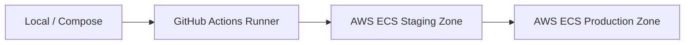

# DevOps, Cloud Infrastructure & Platform Specification: GuardianMail AI

---

## Section 1: Infrastructure Vision

GuardianMail AI's platform engineering vision enforces a Cloud-Native, GitOps-driven, and highly resilient deployment topology:
- **Immutable Infrastructure**: Changes are deployed by rebuilding and replacing container images rather than modifying running servers.
- **Availability Target**: Target 99.99% system availability through multi-availability zone deployments.
- **Cost Optimization**: Right-size CPU and memory allocation for containers based on historical load metrics.

---

## Section 2: Cloud Deployment Architecture

The platform operates across three distinct environment profiles:



- **Production Zone**: ECS Fargate container instances deployed across multiple Availability Zones, backed by AWS Application Load Balancers (ALB) and Cloudflare CDN services.

---

## Section 3: Hardened Containerization

- **Multi-Stage Builds**: Implements multi-stage compilation to keep final production images minimal.
- **Hardening Rules**:
  - Python runtime containers must execute processes under `USER appuser` (UID 10001) instead of the root context.
  - Image builds must run security scanners (like Trivy or Grype) to detect vulnerable dependencies before registry upload.

---

## Section 4: Docker Compose Services

We configure a local multi-container development environment in `docker-compose.yml`:
- **FastAPI Core**: Port `8000`.
- **MongoDB Atlas Proxy**: Directs local database writes to mock replica sets.
- **Celery Worker & Beat**: Offloads async tasks and cron-like jobs (e.g. daily database cleanups).
- **Redis Cache & Broker**: Enforces rate-limiting pools on port `6379`.
- **Monitoring (Prometheus & Grafana)**: Captures API metrics on port `9090` and maps alerts targets.

---

## Section 5: Kubernetes Manifests (Production Ready)

To support migration to Kubernetes, manifests must configure:
- **livenessProbe & readinessProbe**: Path targets mapping `/health/live` and `/health/ready` to manage pod lifecycles.
- **Horizontal Pod Autoscaler (HPA)**: Auto-scales replica pools when CPU utilization exceeds 70%.
- **Network Policies**: Restricts egress and ingress paths to isolate database layers from public internet routing.

---

## Section 6: Infrastructure as Code (IaC)

- **Terraform Directory Structure**: Separates infrastructure components (`vpc.tf`, `ecs.tf`, `databases.tf`).
- **State Management**: Persists Terraform state files in secure S3 buckets with DynamoDB locking.

---

## Section 7: Networking & Access Gateway

- **Reverse Proxy**: Nginx routes public traffic to the backend API services.
- **TLS Termination**: Enforces TLS 1.3 encryption, directing traffic through Let's Encrypt certificates.
- **Private Subnets**: DB endpoints (MongoDB Atlas, AWS ElastiCache) are isolated in private subnets, allowing connections only from the ECS security groups.

---

## Section 8: CI/CD Pipelines

Automated GitHub Actions pipelines verify code quality on every push:
1. **Lint Phase**: Runs Black, Ruff, and Prettier checks.
2. **Test Phase**: Executes Pytest coverage checks.
3. **Security Scan**: Checks packages and code quality using Bandit and Safety.
4. **Deploy Phase**: Automatically builds and pushes hardened Docker images to the registry.

---

## Section 9: Environment Management

- Configurations are separated by profiles: Local, Staging, and Production.
- Secrets are injected at runtime using environment variables. Hardcoded credentials in source control are strictly prohibited.

---

## Section 10: Observability Stack

- **Prometheus**: Scrapes metrics from `/metrics` endpoints.
- **Grafana**: visualizes rate limits, active database connections, and celery task failures.
- **OpenTelemetry Collector**: Receives trace spans from backend code and forwards them to distributed tracking systems.

---

## Section 11: Structured Logging

Logs are formatted in structured JSON to enable easy ingestion by log collectors:
```json
{
  "timestamp": "2026-08-03T12:54:02Z",
  "level": "INFO",
  "request_id": "req-8924b125",
  "correlation_id": "corr-f925b682",
  "message": "Scanned email attachment successfully analyzed."
}
```

---

## Section 12: Platform Monitoring Targets

We monitor key system performance indicators:
- **API Response Latencies**: Triggers alerts when average request duration exceeds 200ms.
- **Redis Cache Hit Ratio**: Monitored to detect cache exhaustion.
- **Celery queue length**: Triggers auto-scaling when the queue size grows, indicating worker lag.

---

## Section 13: Scaling Strategy

- **Stateless Web Nodes**: Backend containers scale horizontally in response to incoming traffic volume.
- **Worker Pools**: Scales Celery container groups based on queue length metrics.

---

## Section 14: Caching Architecture

- **Token Storage**: Blacklisted tokens are saved in Redis with a TTL matching the token's lifetime.
- **Rate Limit Counter**: Uses a sliding window log structure with a 60-second eviction TTL.

---

## Section 15: Storage Architecture

- **Temporary Storage**: Uses volatile local ephemeral volumes for processing files during Tesseract OCR scans.
- **Persistent Storage**: Uploaded attachments and evidence packages are saved in secure object storage.

---

## Section 16: Backup & Disaster Recovery (DR)

- **Automated Backups**: Backups are run daily using cron scripts (`backup.sh`), which compress data, encrypt the archive with AES-256, and upload it to secure storage.
- **Objectives**: RTO < 4 hours; RPO < 1 hour.

---

## Section 17: Release Management

- **Versioning**: Adheres to Semantic Versioning (`MAJOR.MINOR.PATCH`).
- **Deployments**: Uses Blue/Green deployment models for API services to ensure zero downtime.

---

## Section 18: Platform Security Controls

- Enforces image signing using Cosign tools to verify image provenance.
- Scans container images for vulnerabilities during CI/CD build pipelines.

---

## Section 19: Platform Automation

- Database schema migrations are executed automatically during the container startup lifecycle.
- Automates certificate renewals through Nginx integration with certbot.

---

## Section 20: Performance Engineering

- Connection pools are configured with reuse timeouts to prevent socket exhaustion.
- OCR tasks run on optimized worker queues separate from core API request paths.

---

## Section 21: SRE Incident Management & Playbooks

- **On-Call Escalations**: Triggers PagerDuty alerts when API endpoints fail liveness checks.
- **Postmortems**: Blameless postmortems are conducted after any high-priority incident (S1/S2) to identify root causes and improve system resilience.

---

## Section 22: Architectural Decision Records (ADRs)

### ADR-07: Docker Compose for Local Development
* **Decision**: Adopt Docker Compose for local environments instead of running local Kubernetes (e.g. Minikube).
* **Trade-off**: Composed yaml definitions do not match Kubernetes manifests exactly, but significantly reduce developer system overhead and resource constraints while keeping setup simple and fast.
