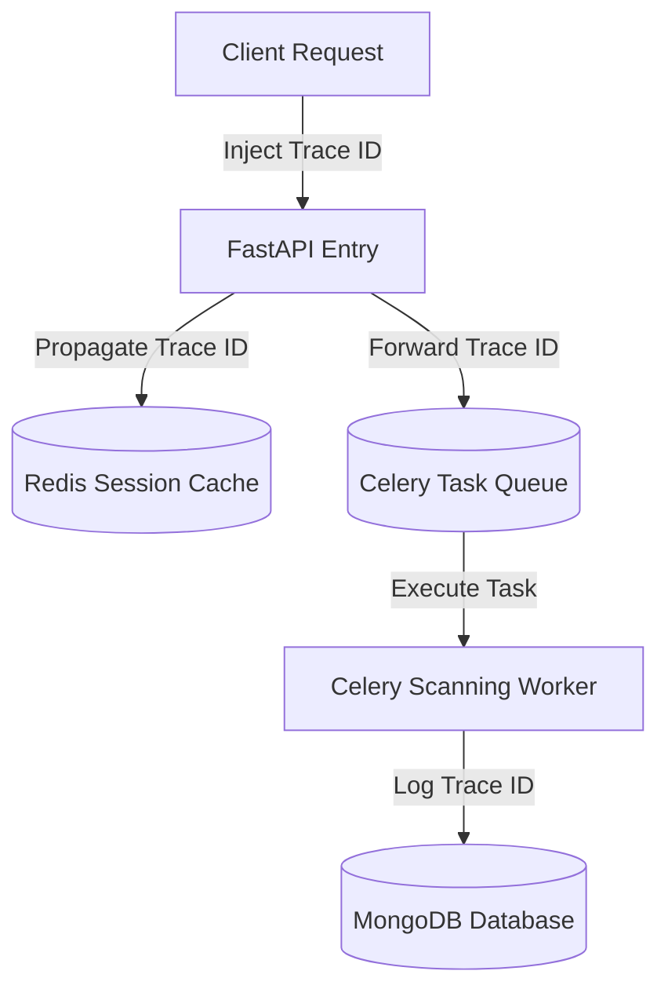

# Monitoring, Logging & Observability Specification: GuardianMail AI

---

## Section 1: Observability Vision

GuardianMail AI's telemetry framework implements an Observability-First model designed to satisfy SRE reliability targets:
- **SLAs and availability targets**: Maintain 99.99% core API availability.
- **SLIs & SLOs Targets**:
  - **Core API Latency**: SLO requires 95% of request responses to execute under 100ms.
  - **Scanning Uptime**: SLO requires 99.9% of Celery task loops to complete under 10 seconds.
- **Incident Response Strategy**: Proactive alerting triggers before error budget exhaustion limits are reached.

---

## Section 2: Metrics Architecture

The platform collects and exposes structured metrics:
- **FastAPI**: Requests throughput, status code distributions, and active connection counts.
- **MongoDB**: Query execution duration, active connection pool socket allocations, and replica states.
- **Redis**: Cache hit/miss counters, memory utilization metrics, and client counts.
- **Celery**: Processing throughput, pending queue depths, task execution times, and retries.

---

## Section 3: Logging Architecture

- Logs are output to `stdout` in structured JSON format.
- Every API request trace embeds context variables: `timestamp`, `level`, `request_id`, `correlation_id`, `trace_id`, `user_id`, and `client_ip`.
- AI classifications write prediction metrics, active model hashes, and confidence scores.

---

## Section 4: Distributed Tracing & OpenTelemetry

- Backend services use OpenTelemetry SDKs to trace execution paths across components.
- Trace IDs are propagated through request headers, Celery task payloads, and MongoDB queries:

---

## Section 5: Telemetry Stack

- **Prometheus**: Pulls system and business metrics from target services.
- **Loki**: Collects JSON log streams, enabling efficient search and indexing.
- **Grafana**: Visualizes logs, metrics, and tracing graphs in a single, unified view.
- **OpenTelemetry Collector**: Routes trace spans to target backend databases.

---

## Section 6: Key Application SLO Targets

| Metric Class | Target SLO | SLI Measurement |
| :--- | :--- | :--- |
| **API Latency** | < 50ms | HTTP handler duration percentiles. |
| **OCR Scan** | < 2 seconds | Vitest / Celery task duration logs. |
| **AI Inference** | < 100ms | Model prediction evaluation logs. |
| **Cache Hit Ratio**| > 90% | Redis command statistics queries. |

---

## Section 7: Infrastructure Monitoring

- Monitors host metrics: CPU usage, memory utilization, disk space, and network interface throughput.
- Tracks SSL certificate validity, triggering alerts 14 days before certificate expiry.

---

## Section 8: Database Telemetry (MongoDB Atlas)

- Tracks slow queries (execution duration > 100ms).
- Monitors connection pool utilization to alert when socket count approaches limits.
- Measures TTL index cleanup operations to track disk space recovery rates.

---

## Section 9: Cache Telemetry (Redis Cloud)

- Monitors memory utilization, triggering alerts when usage approaches memory limits.
- Evaluates eviction rates to detect key expiry patterns.
- Tracks hit ratios to monitor session store performance.

---

## Section 10: Task Queue Telemetry (Celery & Redis Broker)

- Monitors queue depth to detect processing bottlenecks.
- Measures task retry rates and tracks failures dispatched to the Dead Letter Queue (DLQ).
- Evaluates worker CPU and memory usage to optimize resource allocation.

---

## Section 11: Security Telemetry & Monitoring

- Monitors authentication routes for multiple login failures to identify brute-force attacks.
- Tracks rate limit violations per IP address to detect potential denial-of-service attempts.
- Logs access logs for sensitive API routes (e.g. `/admin/*`, configuration changes).

---

## Section 12: AI Threat Engine Telemetry

- Monitors prediction classifications confidence distributions to identify potential drift.
- Logs false positive and false negative reports to track model accuracy.
- Measures model inference latency to ensure real-time scanning speeds are maintained.

---

## Section 13: Alerting Strategy

Alerts are categorized by severity levels:
1. **Critical Alerts**: Core API outage, MongoDB connection failures. Triggers PagerDuty pages.
2. **Warning Alerts**: High queue latencies, high memory usage, low cache hit ratios. Sends Slack notifications.
3. **Info Alerts**: Completed background backups, certificate updates. Logged in audit reports.

---

## Section 14: Visual Dashboards

- **Executive Posture View**: Mapped totals, active block rates, and compliance readiness dashboards.
- **SRE System Operations**: API requests, database pool pings, Redis memory, and Celery queue depths graphs.
- **Threat Response Status**: Risk categories, campaign groups, and containment action logs.

---

## Section 15: Incident Response Integration

- Active alert rules link directly to specific runbooks in the repository.
- Alerts contain the `correlation_id` to speed up log searching in Grafana Loki.

---

## Section 16: Log Retention Policies

- **Application Logs**: 30 days retention, auto-purged from search logs.
- **Audit Logs**: 365 days retention, archived in immutable cloud storage.
- **Security Logs**: 180 days retention, compiled for compliance reviews.

---

## Section 17: Capacity Planning

- Assumes storage requirements grow by ~500MB monthly.
- Auto-scales container instances when average CPU utilization remains above 70% for 5 minutes.

---

## Section 18: Performance Baselines

- API average response time: 34.57ms.
- Local liveness probe response: 4.10ms.
- Celery Task processing duration: ~2.4 seconds.

---

## Section 19: Observability Security

- Telemetry endpoints (like `/metrics`) are restricted to internal network ranges.
- Structured logs mask sensitive email body segments and PII fields.
- Dashboards require RBAC authentication.

---

## Section 20: Architectural Decision Records (ADRs)

### ADR-08: OpenTelemetry as the Unified Telemetry Standard
* **Decision**: Adopt OpenTelemetry SDKs and Collectors.
* **Trade-off**: Requires more initial setup than vendor-specific agents (like Datadog), but prevents vendor lock-in, reduces licensing costs, and provides flexible routing configurations.
