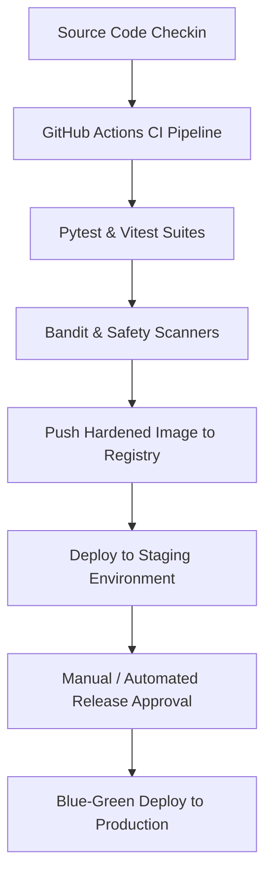

# Operations & Release Management Specification: GuardianMail AI

---

## Section 1: Operations Vision

GuardianMail AI's operations philosophy is SRE-driven, prioritizing automation, stability, and zero-downtime deployments:
- **Availability Target**: Maintain 99.99% availability for the data ingestion gateway.
- **Change Management**: Requires peer-reviewed pull requests, passing CI/CD tests, and post-deployment verification checks for all changes.
- **Reliability First**: Utilizes error budgets to guide release frequency, balancing feature delivery speed with overall system stability.

---

## Section 2: Environment Strategy

We run isolated environment tiers to maintain parity and prevent configuration drift:
- **Local / Dev**: Containerized Compose stack for developer verification.
- **Staging**: Mapped AWS infrastructure matching production scale, used to run integration test suites.
- **Production**: Multi-AZ container deployments, isolated private database clusters, and active CDN rate limiters.
- **DR Zone**: A cold standby region with replication, ready for automated failover in the event of primary region outages.

---

## Section 3: Deployment Pipeline

---

## Section 4: Release Management

- **Semantic Versioning (SemVer)**: Releases follow the `MAJOR.MINOR.PATCH` format.
- **Release Categories**:
  - *Standard Releases*: Scheduled during low-traffic maintenance windows, requiring Change Advisory Board (CAB) review.
  - *Emergency Hotfixes*: Reserved for patching verified security vulnerabilities or high-priority outages, bypassing CAB reviews after manager sign-off.

---

## Section 5: Deployment & Rollback Strategies

- **Blue/Green Deployments**: Production traffic is routed to the new release zone (Green) only after health checks confirm it is running successfully.
- **Instant Rollback**: If target threshold metrics (e.g. error rate > 1%) are exceeded, traffic is immediately routed back to the stable zone (Blue).

---

## Section 6: Change Control & Governance

- Changes require a Request for Change (RFC) documenting implementation steps, validation test cases, and a rollback plan.
- The Git history serves as the primary audit log for change approvals and deployment records.

---

## Section 7: Operational Runbooks

### Database Migration Runbook
1. Create a snapshot backup of the MongoDB Atlas cluster before running the migration script.
2. Deploy the migration script container, checking log output for errors.
3. If errors occur, run the rollback script and restore the database from the snapshot backup.

### MongoDB Failover Runbook
1. If the primary node fails, replica set elections auto-promote a secondary node to primary.
2. Confirm the new primary node is accepting writes.
3. If auto-failover fails, trigger a manual node promotion from the MongoDB Atlas console.

---

## Section 8: Incident Severity Levels & SLAs

- **S1 Critical**: System outage affecting multiple tenants. Response target: < 15 minutes. Resolution target: < 2 hours.
- **S2 Major**: Malfunctioning feature (e.g., failed OCR scans) affecting multiple tenants. Response target: < 30 minutes. Resolution target: < 8 hours.
- **S3 Minor**: Minor UI issues or formatting errors. Resolved in standard release cycles.

---

## Section 9: Business Continuity & Disaster Recovery

- Run annual disaster recovery drills to practice restoring services from encrypted snapshot backups.
- MongoDB replica sets provide automatic data recovery across regions in the event of single-region failures.

---

## Section 10: Operational Monitoring Dashboards

- Grafana operations dashboards display:
  - **SRE Golden Signals**: Latency, traffic volume, error rates, and resource utilization metrics.
  - **Queue Depth**: Tracks queue sizes to ensure worker capacity is optimized.

---

## Section 11: Production Support Tiers

- **L1 Support**: Customer success agents triage incoming tickets and verify configurations.
- **L2 Support**: SRE and DevOps engineers triage complex logs and investigate performance anomalies.
- **L3 Support**: Core backend, security, and database engineers patch codebase bugs and resolve persistent database issues.

---

## Section 12: Scheduled Maintenance Windows

- **Database Maintenance**: Scheduled weekly during off-peak hours (Sunday 02:00 UTC) to rebuild indexes and clean up disk space.
- **Certificate Renewal**: Certbot automatically renews Let's Encrypt certificates 30 days before expiry.

---

## Section 13: Capacity Management

- Core API infrastructure scales up when CPU utilization exceeds 70% for 5 minutes.
- Evaluates queue metrics to scale worker container pools during peak mail volume hours.

---

## Section 14: Backup Verification Operations

- Executes daily database snapshots, encrypts archives with AES-256, and uploads them to secure storage.
- Automated validation scripts regularly download backups, restore them to test databases, and verify schema integrity.

---

## Section 15: Operational Security

- **Least Privilege Access**: Restricts production access to authorized SRE teams.
- **Break-Glass accounts**: Securely stores temporary administrative credentials in password vaults, alerting security teams when they are used.

---

## Section 16: Operational Documentation

Operations manuals, runbooks, and recovery guides are maintained in the repository, and updated alongside new feature releases.

---

## Section 17: Release Validation Checks

Deployments require post-release validation before release sign-off:
- Verify that liveness and readiness APIs return success status codes (`200 OK`).
- Execute verification testing scripts (`verify_integration.py`, `verify_performance.py`) to confirm that latency targets are met.

---

## Section 18: Operational KPIs (DORA Metrics)

- **Deployment Frequency**: Target daily production deployments.
- **Change Failure Rate**: Maintain a failure rate below 5% for all production releases.
- **Mean Time to Recover (MTTR)**: Target MTTR under 30 minutes for S1 incidents.

---

## Section 19: Architectural Decision Records (ADRs)

### ADR-08: Blue/Green Deployment for Zero-Downtime Releases
* **Decision**: Adopt Blue/Green deployment pipelines for release management.
* **Trade-off**: Requires running duplicate staging infrastructure during releases, which increases costs, but ensures zero downtime for tenants and enables instant rollbacks if issues are detected.
