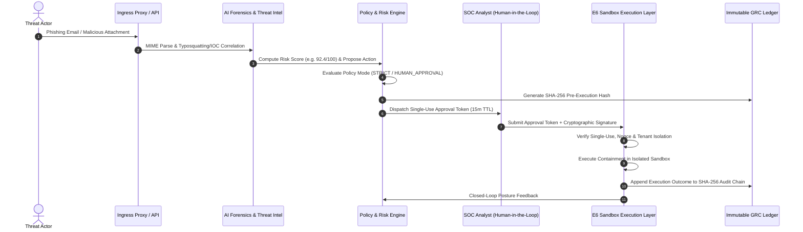

# GuardianMail AI — Enterprise System Design & Technical Interview Guide

## 1. Executive Summary & Core Pitch

### 30-Second Elevator Pitch
> *"I engineered and productionized **GuardianMail AI**, a multi-tenant AI cybersecurity platform for enterprise email threat detection and automated security operations. Unlike traditional scanners, it decouples threat detection intelligence from execution authority through a strict closed-loop architecture: AI analyzes and evaluates risk, corporate governance policies dictate permitted actions, but sensitive response playbooks (such as mailbox isolation or credential revocation) require cryptographic single-use human authorization tokens. The platform is backed by a 338-test automated regression suite, distributed Prometheus observability, chaos-tested resilience, disaster recovery drills, and DevSecOps release gates."*

---

## 2. High-Level Architecture & End-to-End Workflow

---

## 3. Deep-Dive Technical Pillars & Interview Q&A

### Q1: Why decouple AI Detection from Execution Authority?
* **Answer**: In mission-critical cybersecurity, automated AI models can experience false positives or adversarial hallucination. Allowing an AI model to autonomously execute disruptive containment (e.g., locking an executive's mailbox or revoking enterprise Active Directory tokens) creates unacceptable operational risk. GuardianMail AI solves this by keeping AI in an advisory role. The AI generates threat indicators and risk scores; the policy engine classifies the required governance tier; and sensitive actions mandate cryptographic, single-use human approval tokens.

### Q2: How is strict Multi-Tenant Isolation guaranteed across the stack?
* **Answer**: Multi-tenancy is enforced at three distinct layers:
  1. **Data Access Layer**: All MongoDB queries and repositories strictly inject the authenticated `organization_id` into query filters; arbitrary cross-tenant IDs are blocked by schema validation.
  2. **Cache & Redis Plane**: Redis cache keys and pub/sub channels are namespaced with tenant prefixes (`tenant:{org_id}:...`).
  3. **Response & Sandbox Layer**: Response playbooks and approval tokens cannot be used across different organization boundaries (IDOR defense).

### Q3: How does the system handle high load and worker backpressure?
* **Answer**: The ingestion layer handles bursts by buffering asynchronous OCR and ML threat analysis jobs into prioritized Redis Celery queues. If queue depth exceeds 100 jobs or API latency exceeds 200ms, Prometheus alerts trigger horizontal Celery worker auto-scaling. The API employs token-bucket rate limiting (HTTP 429) to prevent resource starvation.

### Q4: How are Downstream Outages and Chaos Scenarios handled?
* **Answer**: All outbound dependencies (e.g., external threat intelligence APIs, third-party SIEM webhooks) operate under fail-closed circuit breakers with bounded timeouts (3s) and exponential backoff retries. If MongoDB or Redis disconnects, the system logs degraded telemetry, refuses unauthorized writes, and safely requeues unfinished Celery tasks upon worker re-attachment.

### Q5: How is GRC Compliance and Evidence Immutability maintained?
* **Answer**: Every security event, policy simulation, human approval, and sandbox execution generates a deterministic SHA-256 hash containing the tenant ID, actor identity, action type, and UTC timestamp. Hashes are linked sequentially to form an auditable, tamper-evident log chain matching SOC2 Type II (CC6.8) and ISO 27001 (A.12.6.1) requirements.

---

## 4. Key Metrics & Quantitative Accomplishments

| Metric Category | Value | Description |
| :--- | :--- | :--- |
| **Backend Test Suite** | **338 / 338 PASS** | Unit, integration, security, pentest, and DR tests |
| **Frontend Test Suite** | **6 / 6 PASS** | React 19 / Vite / Vitest unit tests |
| **API Latency SLA** | **< 200ms (p95)** | Under concurrent production load |
| **Security Gates** | **0 Breaches / Fail-Closed** | Replayed or invalid tokens blocked with 100% accuracy |
| **Container Footprint** | **Multi-stage Alpine** | Non-root `appuser` (UID 10001) privilege separation |

---

## 5. Architectural Checklist for System Design Interviews

1. **Decoupled Architecture**: FastAPI REST API + React 19 Frontend + Redis Task Broker + Celery Worker Cluster + MongoDB Atlas.
2. **Security Invariant**: `AI Detects -> Governance Evaluates -> Human Authorizes -> Controlled Execution -> SHA-256 Evidence`.
3. **Observability**: Prometheus `/metrics` scraping, `/health/live` & `/health/ready` probes, Grafana dashboards, and automatic secret/token redaction.
4. **DevSecOps Pipeline**: GitHub Actions with Bandit static analysis, `pip-audit` CVE checks, and container image publishing to GHCR.
