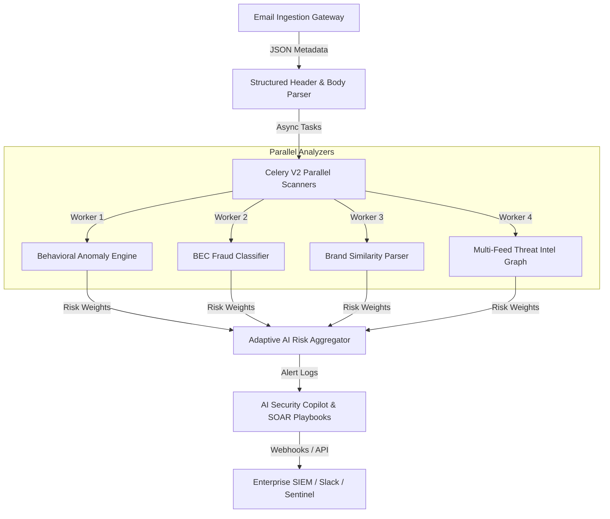

# GuardianMail AI Version 2.0 - Technical Architecture & AI Evolution Blueprint

This blueprint describes the system flows, behavioral detectors, threat intelligence layers, and security orchestration integrations for the **GuardianMail AI Version 2.0** platform.

---

## 1. Version 2.0 High-Level Architecture

---

## 2. Behavioral Email Analysis Engine

The Behavioral Engine analyzes historical sender metrics to compute a **Behavioral Anomaly Score** (range: `0.0 - 1.0`):
- **Communication Pattern**: Checks frequency ratios. Let $F_d$ be the average number of messages per day from the sender domain. Spikes ($F_{today} > 5 \times F_d$) raise anomalies.
- **Time Window Anomaly**: Scans message delivery timestamps against the sender's average timezone profile. Out-of-hours delivery raises flags.
- **Attachment Behaviors**: Compares file sizes and content hashes against a clean history whitelist database.

---

## 3. Business Email Compromise (BEC) Fraud Engine

Detects financial manipulation, impersonation, and vendor invoice scams:
- **Lexical Classifiers**: Extracts billing-related instructions (e.g. "wire transfer", "payment details update", "payroll change").
- **Sender Authority Scoring**: Computes the executive similarity score. E.g. checks display names resembling company VIPs but with a non-company domain suffix.
- **Explainable reasoning**: The engine generates automated natural-language explanations (e.g., *"This message displays CEO John Doe's name but was sent from an external domain, requesting an urgent wire transfer to an unknown bank account."*).

---

## 4. Brand Impersonation & Homograph Engine

Detects look-alike domains and domain spoofing:
- **Unicode Homograph Check**: Evaluates Punycode representations (`xn--...`). Flags domains using cyrillic characters to mimic popular brands (e.g., swapping Latin 'a' with Cyrillic 'а').
- **Domain Similarity**: Computes **Levenshtein Distance** between the sender domain and known top-tier brand domains. Domains with a distance of `1` or `2` are flagged (e.g., `micros0ft.com`, `paypa1-security.com`).
- **SPF/DKIM/DMARC alignment**: Flags any mismatches between header values.

---

## 5. Threat Intelligence Knowledge Graph

Correlates metadata indicators from multiple feeds:
- **IOC Correlation**: Combines IP addresses, domain names, file hashes, and URL endpoints into unified indicators of compromise (IOCs).
- **Reputation score mapping**: Links ASNs and hosting providers to campaign threat profiles.

---

## 6. SOAR Orchestration & Enterprise Integrations

Automates security playbooks via webhook triggers:
- **Auto-Quarantine**: Automatically moves emails to quarantine folders if threat scores exceed `85%`.
- **Auto-Block**: Dynamically injects malicious sender domains into firewall block lists.
- **SIEM Connectors**: Pre-configured JSON data templates for pushing incident logs directly to Splunk and Microsoft Sentinel.
